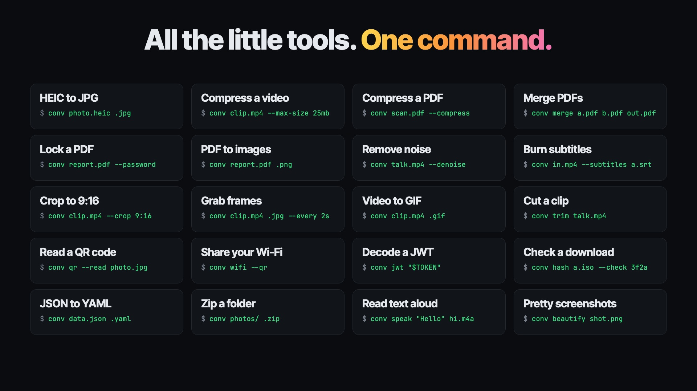

<h1 align="center">
  <picture>
    <source media="(prefers-color-scheme: dark)" srcset="docs/media/convkit-logo-dark.svg">
    
  </picture>
</h1>

<p align="center"></p>

<a href="docs/media/convkit-launch.mp4"></a>

<p align="center"><a href="docs/media/convkit-launch.mp4">▶ Watch the 22-second demo</a></p>

convkit is a free, offline toolbox for the file and text jobs people
usually pay an app for or hand to a website. One command, `conv`, converts
and compresses files, edits video and sound, merges, locks and shrinks
PDFs, reads QR codes, formats JSON and checks downloads, all on your own
machine. Nothing is uploaded, and there's no account, watermark or file
size limit.

```console
conv photo.heic .jpg                 # instead of a HEIC converter site
conv clip.mp4 --max-size 25mb        # instead of a video compressor
conv scan.pdf --compress             # instead of an online PDF compressor
conv merge a.pdf receipt.jpg out.pdf # instead of a PDF merger
conv report.pdf --password           # instead of a paid PDF editor
conv talk.mp4 --denoise              # instead of a noise removal service
conv clip.mp4 .jpg --every 2s        # instead of a frame extractor
conv clip.mp4 --subtitles subs.srt   # instead of a subtitle burner
conv qr --read photo.jpg             # instead of a QR scanner
conv jwt "$TOKEN"                    # instead of pasting a token into a decoder
conv data.json .yaml                 # instead of a JSON to YAML site
conv photos/ .zip                    # instead of an archive app
```

Under the hood conv picks the right tool for each job (ffmpeg,
ImageMagick, LibreOffice, pandoc, Typst, qpdf or the system's own speech
engine) and runs it with settings tuned for that conversion. The data
formats, archives and text tools are built in. That's 312 conversion pairs
across 47 formats (`conv capabilities` lists them), plus the commands in
[Quick start](#quick-start). The only things that go online are `conv
install` and `conv update`, which fetch backends, and `conv link --follow`
when you ask it to.

```console
$ conv clip.mkv clip.mp4
OK clip.mp4 - 55 KB - 0.1s - stream copy, no re-encode
  /home/user/Videos/clip.mp4
```

Where it can, conv avoids re-encoding: a video whose codecs already fit the
new container is copied, which is lossless and measured 3.3× faster on a
2-second clip up to 71.7× on a 60-second 1080p one. On a real terminal
`OK`/`FAIL` render as green/red `✓`/`✗`; piped or redirected output (CI,
`| tee`) is plain ASCII with no escape codes.

## Install

Prebuilt binaries cover Windows x64, macOS x64/arm64, and Linux x64/arm64:

```console
# Linux / macOS
$ curl --proto '=https' --tlsv1.2 -LsSf \
    https://github.com/shdwfruit/convkit/releases/latest/download/convkit-installer.sh | sh
```

```powershell
# Windows
> irm https://github.com/shdwfruit/convkit/releases/latest/download/convkit-installer.ps1 | iex
```

```console
# Homebrew (macOS / Linux)
$ brew install shdwfruit/tap/convkit
```

An MSI (`convkit-x86_64-pc-windows-msvc.msi`) is also attached to each
release. The Windows binaries are not code-signed, so SmartScreen warns on
first run.

```console
# Cargo (any platform, builds from source)
$ cargo install convkit --locked
```

Building from source — which `cargo install` does — requires Rust 1.85+ and
a C toolchain on every platform (the HTTPS downloader's `ring` dependency
compiles C at build time). On Windows that toolchain is the MSVC C++ build
tools rustup already requires, so nothing extra is needed beyond a working
Rust install. From a checkout:

```console
$ git clone https://github.com/shdwfruit/convkit
$ cd convkit
$ cargo install --path crates/conv
```

convkit performs no encoding itself — see [Backends](#backends). Running a
conversion also prompts to install whichever backend it needs.

## Quick start

```console
conv in.mp4 out.gif              # target inferred from output extension
conv in.mp4 .gif                 # same basename, new extension
conv in.mp4 .gif -o ./clips      # same, written into another folder
conv *.heic --to jpg             # batch; globs expanded by conv itself, so this works on Windows too
conv ./photos --to jpg -o ./out  # folder input, non-recursive, outputs redirected
conv a.png b.png out.pdf         # merge two or more images into one PDF
conv merge a.pdf b.pdf out.pdf   # join PDFs into one
conv merge scan.pdf receipt.jpg out.pdf  # PDFs and photos in one PDF
conv merge a.mp4 b.mov out.mp4   # join videos, losslessly when they match
conv split report.pdf 1-3 4-z    # one PDF per page range
conv pages report.pdf 3 1-2 5-z  # pick, reorder, delete or turn a PDF's pages
conv report.pdf --password       # lock a PDF; --unlock removes the password
conv report.pdf .png             # each page of a PDF as a picture
conv scan                        # list the files here and what each can become
conv info clip.mp4               # what a file is: streams, size, camera, pages
conv clip.mp4 --max-size 5mb     # compress a video to fit under 5 MB
conv photo.jpg --strip-metadata  # remove the location and other metadata
conv clip.mp4 --start 5 --end 12 # cut out 0:05 to 0:12
conv clip.mp4 --speed 2          # play twice as fast
conv talk.mp4 --denoise          # take out background noise and hum
conv IMG_0042.mov --rotate left  # turn a sideways video or photo
conv clip.mp4 --crop 9:16        # crop to a shape, a box, or auto for black bars
conv clip.mp4 --audio song.mp3   # replace the sound; add --mix to put it under
conv clip.mp4 --subtitles subs.srt # burn subtitles into the picture
conv selfie.jpg --flip h         # mirror a photo or video
conv clip.mp4 .png --start 0:12  # save the frame at 0:12 as a picture
conv trim talk.mp4               # find clips in the terminal and cut them
conv --paste .jpg                # convert the picture or files you copied
conv photo.heic .jpg --copy      # convert, then copy the result to paste anywhere
conv qr "https://example.com"    # make a QR code, written as qr.png
conv qr --read photo.jpg         # print what the QR codes in a picture say
conv ascii photo.jpg             # print a picture as ASCII art
conv data.json .yaml             # JSON, YAML, TOML and CSV, converted with no backend
conv fmt data.json               # pretty-print and check JSON, YAML or TOML
conv notes.txt .m4a              # read a text aloud into a sound file
conv speak "Hello" hello.m4a     # read the words given aloud
conv beautify shot.png           # a screenshot on a gradient, ready to post
conv colors photo.jpg            # the main colours of a picture
conv wifi --qr                   # a QR code that joins your Wi-Fi
conv changelog --since 0.5.1     # what's new since the version you had
conv hash a.iso --check 3f2a...  # does the download match?
conv link --paste --copy         # the copied link, without its tracking
conv photos/ .zip                # make photos.zip
conv photos.zip                  # open it
```

A single conversion reports size, elapsed time, and the absolute path the
result landed at:

```console
$ conv clip.mp4 clip.gif
OK clip.gif - 492 KB - 0.2s
  /home/user/Videos/clip.gif
```

A note follows when there is something to know about converting this
particular source: a transparent PNG flattened into a JPEG, say, or a GIF
made from a long video, which takes a lot of memory. A phone photo converted
to JPEG gets one only if it records where it was taken; see
[Location and metadata](#location-and-metadata).

```console
$ conv logo.png logo.jpg
OK logo.jpg - 5 KB - 0.0s
  /home/user/Pictures/logo.jpg
  note  Transparency is flattened onto a white background; JPEG has no alpha channel.
```

`--dry-run` prints the exact backend command instead of running it — here,
the per-clip palette generation behind convkit's GIF default:

```console
$ conv clip.mp4 clip.gif --dry-run
ffmpeg -i clip.mp4 -vf 'fps=15,scale=w=min(640\,iw):h=-2:flags=lanczos,split[a][b];[a]palettegen=stats_mode=diff[p];[b][p]paletteuse=dither=bayer:bayer_scale=3' -loop 0 -y clip.gif
```

Multi-step recipes are automatic: `md → pdf` needs no LaTeX — pandoc renders
to `.docx`, then LibreOffice renders that to PDF, behind one command:

```console
$ conv sample.md sample.pdf --dry-run
pandoc sample.md --standalone --resource-path . -o sample.convkit-step0.docx
soffice "-env:UserInstallation=<per-run temp profile>" --headless --norestore --convert-to pdf --outdir . sample.convkit-step0.docx
```

For the image → PDF merge: three or more positionals, where every one but
the last is an image and the last is `.pdf`, become one multi-page PDF — one
page per input, in argument order; formats can mix. A directory there
expands to its images in natural order (`p2` before `p10`). Two positionals
are always an ordinary pair: `conv a.png out.pdf` converts one file.

A workbook (`xlsx`, `xls`, `ods`) goes to PDF fitted to the page.
LibreOffice prints a number too wide for its column as `###`, and cuts a
sheet wider than the page into strips across several pages. conv widens
only the columns that would print `###`, and scales a sheet wider than its
page down to the page width, keeping the paper size and orientation. A sheet
the workbook already scales, or gives a print range, is left as it is. The
notes say what changed:

```console
$ conv book.xlsx book.pdf
OK book.pdf - 44 KB - 2.3s
  /home/user/Documents/book.pdf
  note  Widened 1 column whose numbers would otherwise print as ###.
  note  Scaled 1 sheet down to fit the page width, to 37%.
```

JPG, PNG, WebP and GIF go into a PDF through Typst, which conv can install
for you. Each picture gets a page of its own size, upright as its EXIF says,
and a JPEG goes in as it is, without being re-encoded. PNG and WebP pages
are kept without loss, so a PDF of photos in those formats can come out
several times their size; conv says when that happens, and `--quality`
stores them as JPEG instead. An animated GIF or WebP contributes its first
frame. HEIC, HEIF, AVIF, TIFF and BMP need ImageMagick, and so do
`--quality`, `--resize` and `--rotate`, which re-encode the pictures. Any
one of them sends the whole merge through ImageMagick. An SVG or ICO can't
start a merge, but later in the list it goes in through ImageMagick too.
Without Typst, ImageMagick merges JPG, PNG, WebP and GIF as well,
re-encoding them, and conv says so.

A failure never looks like a success, and carries its own fix — `try` names
whichever package manager is on `PATH` (winget/scoop/choco, brew,
apt-get/dnf/pacman):

```console
$ conv report.xlsx report.pdf
FAIL report.xlsx -> pdf
  soffice not found
  try  brew install --cask libreoffice
```

Exit codes, for scripting: `0` success, `1` conversion failed, `2` usage
error or unsupported pair, `3` a required backend is missing, `4` a batch
partly failed.

## Tuning knobs

Three flags override named defaults on image conversions:

- `--resize <GEOMETRY>` — fit within the geometry, aspect preserved:
  `1600x900`, `1600x` (width only), `x900` (height only), or `50%`.
  It never enlarges; see `--upscale` below.
- `--quality <1-100>` — lossy image targets (jpg/webp/avif/heic); the
  default is 92, and 60 for heic, whose encoder counts on its own scale
  (60 makes a photo about the size a phone writes). It also applies to
  image → pdf, where it re-encodes the pictures with ImageMagick.
- `--colors <2-256>` — palette reduction on raster targets.

With just an input, `--resize` keeps the file's format and puts the size in
the name: `conv photo.jpg --resize 50%` writes `photo-50pct.jpg` next to the
original, and `conv clip.mp4 --resize 1280` writes `clip-1280w.mp4`.

A flag that doesn't apply to the requested pair is refused with the reason,
never silently ignored:

```console
$ conv in.jpg out.png --quality 80
FAIL in.jpg -> png
  png is lossless; --quality applies to jpg/webp/avif/heic targets and image -> pdf
```

`--fps` and `--crf` override two more named defaults on video and GIF
conversions; `--resize` above widens to both as well:

- `--fps <RATE>` — cap the frame rate; a source already slower is left
  unchanged.
- `--crf <N>` — constant-quality anchor for the encoder: 0-51 for
  mp4/mov/mkv, 0-63 for webm; the default is 20. The 0-51 bound is
  convkit's own, not libx264's, which accepts far more without
  complaint.

```console
$ conv --fps 24 --resize 1280x720 sample.mkv out.mp4
OK out.mp4 - 62 KB - 0.3s
  /home/user/Videos/out.mp4
  note  Re-encoded rather than stream-copied, because a video knob changes the picture; the copy path cannot filter.
```

Binding any video or GIF knob gives up convkit's auto-remux stream
copy — ffmpeg refuses a filter alongside `-c:v copy`, so honouring the
knob means re-encoding — and the note above says so. A cap that does
not actually bind keeps the copy:

```console
$ conv --fps 30 slow24.mp4 slow24.mkv
OK slow24.mkv - 17 KB - 0.2s - stream copy, no re-encode
  /home/user/Videos/slow24.mkv
  note  Source is 24 fps; --fps 30 left it unchanged.
$ conv --resize 4000x clip.mkv clip.mp4
OK clip.mp4 - 768 KB - 0.1s - stream copy, no re-encode
  /home/user/Videos/clip.mp4
  note  Source is 1280x720; --resize 4000x left it unchanged (add --upscale to enlarge).
```

`--resize` never enlarges, on image, video and GIF targets alike: a
source already smaller than the geometry keeps its own size, and a
note says so. `--upscale` lets it enlarge, and conv warns when it
does, with the new size, how many times the source's pixels that is,
and a rough file size, because enlarging adds no detail and makes a
much larger file:

```console
$ conv --resize 1920x --upscale clip.mkv big.mp4
OK big.mp4 - 13.8 MB - 4.6s
  /home/user/Videos/big.mp4
  note  Re-encoded rather than stream-copied, because a video knob changes the picture; the copy path cannot filter.
warning  --resize 1920x --upscale enlarges the 1280x720 source to 1920x1080, about 2.2 times its pixels: enlarging adds no detail, so expect a soft picture and a much larger file, very roughly 1.6 MB to 16 MB.
```

Past four times the source's pixels (more than doubling each side),
conv asks first, as it does for an extreme `--max-size` target:
`--yes` answers yes, and a run that cannot ask (no terminal, `--json`
or `--quiet`) converts nothing and exits 2. One question covers a
whole batch, and `--dry-run` shows the warning without asking.

```console
$ conv --resize 3840x --upscale clip.mkv big4k.mp4
warning  --resize 3840x --upscale enlarges the 1280x720 source to 3840x2160, about 9 times its pixels: enlarging adds no detail, so expect a soft picture and a much larger file, very roughly 6.2 MB to 62 MB.
Convert anyway? [y/N] n
error: large upscale not confirmed for clip.mkv; pass --yes to convert anyway
```

The file size is a rule of thumb and can be off several-fold either
way. An image's size is read from its header, and only under
`--upscale`: every input and page the conversion takes, an SVG at the
density it renders at, and the one enlarged most is the one the
warning names and the question is decided on. If a size cannot be
read, conv warns without the numbers and does not ask, unless the
geometry is a percentage, whose ratio is known regardless.

An `.ico` is the one place conv enlarges without being asked. An icon
holds every size from 16 to 256 px, so a smaller source is enlarged for
the sizes above it, and a warning names them:

```console
$ conv tiny.png .ico
OK tiny.ico - 109 KB - 0.1s
  /home/user/Pictures/tiny.ico
warning  The 32x32 source is enlarged for the 48, 64, 128 and 256 px icon sizes: enlarging adds no detail, so they look soft. A source 256 px or more on its longer side fills every size.
```

An out-of-range `--crf` is refused rather than passed through to the
encoder:

```console
$ conv --crf 60 sample.mkv out.mp4
FAIL sample.mkv -> mp4
  --crf 60 is out of range for mp4; libx264 takes 0-51, lower is better
```

A flag that doesn't apply to the requested pair is refused with the
reason, never silently ignored, on video exactly as on images:

```console
$ conv --fps 24 photo.png out.jpg
FAIL photo.png -> jpg
  --fps does not apply to png -> jpg: it tunes video and GIF targets
```

`conv capabilities <format>` lists which flags apply to which pair,
and each pair's own defaults:

```console
$ conv capabilities mp4
mp4 (Video)

  as source, converts to:
    mp4 -> mov      [--resize --upscale --fps --crf --strip-metadata --start --end --duration --speed --shift-pitch --max-size]
    mp4 -> mkv      [--resize --upscale --fps --crf --strip-metadata --start --end --duration --speed --shift-pitch --max-size]
    mp4 -> webm     [--crf --resize --upscale --fps --strip-metadata --start --end --duration --speed --shift-pitch --max-size]
    mp4 -> mp3      [--strip-metadata --start --end --duration --speed --shift-pitch]
    mp4 -> m4a      [--strip-metadata --start --end --duration --speed --shift-pitch]
    mp4 -> wav      [--strip-metadata --start --end --duration --speed --shift-pitch]
    mp4 -> flac     [--strip-metadata --start --end --duration --speed --shift-pitch]
    mp4 -> opus     [--strip-metadata --start --end --duration --speed --shift-pitch]
    mp4 -> ogg      [--strip-metadata --start --end --duration --speed --shift-pitch]
    mp4 -> gif      [--resize --upscale --fps --strip-metadata --start --end --duration --speed --shift-pitch]

  as target, accepts: mov mkv webm avi gif
  tuning flags when writing mp4: --resize --upscale --fps --crf --strip-metadata --start --end --duration --speed --shift-pitch --max-size

  defaults: crf 20 (override with --crf)
  note: Subtitle tracks and any audio tracks beyond the first are dropped (--max-size keeps every audio track and every text subtitle).
  note: A looping GIF becomes a single play in MP4; there is no container-level loop flag to carry it over.

  full pair list: conv capabilities; exact command preview: conv <in> <out> --dry-run
```

## Location and metadata

Phone photos and videos record where they were taken, and a converted copy
keeps that in most formats. conv says so when it applies:

```console
$ conv IMG_0042.heic IMG_0042.jpg
OK IMG_0042.jpg - 2.5 MB - 0.4s
  /home/user/Pictures/IMG_0042.jpg
  note  The source records a GPS location, and the jpg keeps it; add --strip-metadata to remove it.
```

`--strip-metadata` removes it, and the rest of the metadata with it: the
camera, its serial number, the owner's name, the capture time. An image
keeps only its colour profile, and is turned upright first, so it comes out
neither sideways nor with shifted colours. When Typst makes a PDF, a JPEG is
not re-encoded for this: the one in the PDF is a copy with its metadata
taken out, except the orientation and resolution, so the page comes out the
same size and the same way up. The original is not touched. Video and audio
keep their title, artist, album, album artist, composer, genre and track and
disc numbers, as well as cover art and rotation, and a stream copy stays a
stream copy:

```console
$ conv IMG_0042.heic IMG_0042.jpg --strip-metadata
OK IMG_0042.jpg - 2.5 MB - 0.3s
  /home/user/Pictures/IMG_0042.jpg
$ conv IMG_0043.MOV IMG_0043.mp4 --strip-metadata
OK IMG_0043.mp4 - 24 KB - 0.1s - stream copy, no re-encode
  /home/user/Pictures/IMG_0043.mp4
```

With one file and no output, conv keeps the format and adds `-stripped` to
the name, by the same rules as `--max-size`. A jpg, webp, avif or heic is
re-encoded to do it, since ImageMagick cannot take metadata out any other
way, and the note says so; video and audio are copied. conv cannot write
`.heif`, so a HEIF file needs `--to heic`.

```console
$ conv IMG_0042.jpg --strip-metadata
OK IMG_0042-stripped.jpg - 2.5 MB - 0.3s
  /home/user/Pictures/IMG_0042-stripped.jpg
  note  The jpg is re-encoded at quality 92 to remove its metadata; ImageMagick cannot take it out of a jpg without re-encoding.
```

A batch writes into a `stripped` folder next to its files, under their own
names, unless you give `-o`. The originals stay as they are, and running the
same command again converts only what is new:

```console
$ conv photos --to jpg --strip-metadata
OK 3 converted - 0 skipped - 0 failed - 0.5s
  /home/user/photos/stripped
```

Track languages and chapter names go with the other tags, and a note says
so when the file has them. Cover art is kept as it is, so a cover made from
a phone photo can still carry that photo's EXIF.

The note goes by the EXIF in an image's header and the tags ffprobe
reports. A WebP source never gets it, because its header read loads no
EXIF, and neither does a location kept only in XMP. With ImageMagick 6
(what Debian and Ubuntu install) a HEIC photo gets no note either, since
ImageMagick 6 cannot read a HEIC's EXIF itself. The flag removes all of
these anyway. Documents are not covered yet, and the flag is refused on
them.

## Size targets

`--max-size` makes a video or a PDF fit a size, for upload limits and
attachments. A PDF climbs a ladder of image settings instead; see
[Compress PDF](#compress-pdf). For video:

```console
$ conv clip.mp4 --max-size 10mb
OK clip-10mb.mp4 - 9.99 MB - 23.6s
  /home/user/Videos/clip-10mb.mp4
  note  Sized to 1920x1080 at 30 fps, 3.76 Mb/s video, 128 kb/s audio; 2 passes.
```

conv picks the resolution, frame rate and bitrates together. Each costs
something, and it takes the combination that costs least in total, so a
tight target trims a little from everything rather than all of one thing:
a 144 fps clip loses frame rate long before it drops to 360p. The size is a
ceiling: `10mb` means 10,000,000 bytes, which also fits a limit enforced as
10 MiB. `kb`, `mb` and `gb` are decimal; write `kib`, `mib` or `gib` for
binary units. The targets are mp4, mov, mkv, webm and pdf; any other target
refuses the flag by name.

It encodes in two passes and checks the result. If the file comes out over,
conv plans again with a smaller budget and runs both passes again, three
attempts at most. Very detailed footage can stop the encoder short of the
rate it was asked for at a given picture size; when that happens, the retry
also steps down to a smaller picture. A result still over after the last
attempt is kept and flagged, never thrown away, and the exit code stays 0;
a script reads `over_target` in `--json`. A file already under the target
is copied rather than re-encoded, or stream-copied into another container
where that container can hold its video (an H.264 mp4 going to webm is
re-encoded). A `--resize` or `--fps` limit that would change the file
forces the encode. A file already under the target that is re-encoded
aims at its own size, not the target: an encode cannot add quality the
source lacks, so the result lands within a few percent of the file it came
from rather than growing toward the target.

With one file and no output name, conv keeps the format and adds the size
to the name (`clip-10mb.mp4`), but only when the output would otherwise
land on the input: with `-o` to another directory the name is kept. Name an
output, or use `--to` for a batch, as usual. An output that is the input
itself is refused, even with `-y`, and so is an existing output in the
input's own format: in a folder of two clips, the shell turns
`conv *.mp4 --max-size 8mb` into `conv a.mp4 b.mp4 --max-size 8mb`, which
would replace `b.mp4` with a sized copy of `a.mp4`. A batch needs `--to`,
and writes into a folder named after the size next to its files
(`8mb/clip.mp4`), unless you give `-o`. A folder input never reads that
folder back, so running the same batch again sizes only what is new:

```console
conv clip.mov small.mp4 --max-size 25mb   # name the output
conv *.mov --to mp4 --max-size 8mb        # a batch: each file is sized on its own, into 8mb/
```

`--resize` and `--fps` become limits it stays within. What they cut is your
choice, so it never makes a target count as too small by itself. `--crf`
asks for the opposite (a constant quality, whatever the size) and cannot be
combined with `--max-size`.

If a target is too small to look good, conv says so before encoding,
suggests a size that would, and asks:

```console
$ conv clip.mp4 --max-size 1mb
warning  Extreme compression: 1 MB for 20 s of 1080p will look poor (480p, 30 fps).
         For a watchable result, try: conv clip.mp4 --max-size 2mb
Convert anyway? [y/N] n
error: extreme compression not confirmed for clip.mp4; pass --yes to convert anyway, or try --max-size 2mb
```

Where that line sits, and how it was measured, is in the "Size targets"
section of [`docs/defaults-calibration.md`](docs/defaults-calibration.md#size-targets---max-size).

Scripts answer with `--yes`. Without a terminal to ask, and without
`--yes`, nothing is converted and the exit code is 2:

```console
$ conv clip.mp4 --max-size 1mb < /dev/null
warning  Extreme compression: 1 MB for 20 s of 1080p will look poor (480p, 30 fps).
         For a watchable result, try: conv clip.mp4 --max-size 2mb
error: extreme compression not confirmed for clip.mp4; pass --yes to convert anyway, or try --max-size 2mb
$ echo $?
2
$ conv clip.mp4 --max-size 1mb --yes
warning  Extreme compression: 1 MB for 20 s of 1080p will look poor (480p, 30 fps).
         For a watchable result, try: conv clip.mp4 --max-size 2mb
OK clip-1mb.mp4 - 973.83 KB - 38.6s
  /home/user/Videos/clip-1mb.mp4
  note  Sized to 854x480 at 30 fps, 251 kb/s video, 128 kb/s audio; 4 passes (1 retry).
```

The last run needed a retry, which the note counts. A retry never escalates
to extreme compression on its own: without `--yes` (or a `y`), an
over-target result is kept and flagged, with a note naming `--yes` and a
size to try.

`--json` and `--quiet` also refuse an extreme conversion without `--yes`,
even on a terminal. A batch asks once for all its extreme files, and a no
converts none of them.

`--dry-run` probes the file and prints both passes of the first attempt.
`--json` adds a `sizing` object to each result: the choice it made, the
number of attempts, and `over_target`.

## Cutting a clip

`--start` and `--end` keep part of a video or audio file:

```console
$ conv talk.mp4 --start 1:02 --end 1:10
OK talk-1m02s-1m10s.mp4 - 2.4 MB - 0.9s
  /home/user/Videos/talk-1m02s-1m10s.mp4
  note  Re-encoded rather than stream-copied, because a copied cut can only start on a keyframe; this one starts exactly at 1:02.
```

Times are seconds (`90`, `90.5`), `m:ss` (`1:02.5`) or `h:mm:ss`
(`1:02:03`). A leading `-` counts back from the end: `--start -30` keeps the
last 30 seconds and `--end -5` drops the last 5. `--duration 8` can stand in
for `--end`.

With one file and no output name, conv keeps the format and puts the range
in the name, the way `--max-size` puts the size there, and it does so with
`-o` too, so two clips of one file never share a name. Name an output to
change the format too; GIF and audio targets cut the same way:

```console
conv talk.mp4 clip.gif --start 1:02 --duration 4
conv memo.m4a .mp3 --start 0:10 --end 0:40
```

The cut starts and ends on the exact frames you asked for. A stream copy
can only start on a keyframe, which can be seconds earlier, so a cut that
starts after 0 re-encodes the video, and the note says so. A cut from the
start keeps the copy, unless the video has B-frames (frames stored after
ones shown later), which would carry a copy past the end:

```console
$ conv screen.mp4 --end 30
OK screen-0s-30s.mp4 - 5.8 MB - 0.1s - stream copy, no re-encode
  /home/user/Videos/screen-0s-30s.mp4
```

A clip leaves out the source's chapters. An end past the file stops at its
end, and a note says so. In a batch the range applies to every file, a
negative time counts from each file's own end, and a file shorter than the
start fails on its own. A batch writes into a folder named after the range
(`1m02s-1m10s/talk.mp4`), the way a sized batch does, unless you give `-o`.
`--max-size` sizes the clip rather than the whole file, and `--fps`,
`--resize` and `--crf` work as usual. On an image or a document the flags
are refused, with the reason.

To find the times without opening a player, `conv trim talk.mp4` shows the
file in the terminal: the frame under a slider, a bar of the video's
colors and a bar of its loudness. ←/→ move the slider 10 ms a press and
2 s a second while held, PgUp/PgDn jump, and `+`/`-` zoom the bars. `c`
marks a clip's start, then its end. A clip keeps the picture and the
sound; select a bar with ↑/↓ and Enter to keep that alone, a silent video
or the sound as m4a. `w` writes every clip the way the flags would, and
`q` quits:

```console
$ conv trim talk.mp4
OK talk-1m00s-3m00s.mp4 - 36.6 MB - 11.0s
  /home/user/Videos/talk-1m00s-3m00s.mp4
  note  Re-encoded rather than stream-copied, because a copied cut can only start on a keyframe; this one starts exactly at 1:00.
OK talk-3m00s-4m00s.m4a - 951 KB - 0.2s - stream copy, no re-encode
  /home/user/Videos/talk-3m00s-4m00s.m4a
```

In kitty, Ghostty, WezTerm and iTerm2 the picture is sent through their
graphics, as sharp as the file. Elsewhere it is drawn in characters:
sextants, six pixels to a character, or half blocks in Apple's Terminal,
whose fonts lack sextants. `--graphics` picks one. Without a terminal,
piped or under `--json`, it refuses and points at `--start` and `--end`.

## Changing speed

`--speed` plays a video or audio file faster or slower: `2` (or `2x`) is
twice as fast, `0.5` half as fast, anywhere from 0.01 to 100.

```console
$ conv lecture.mp4 --speed 1.5
OK lecture-1.5x.mp4 - 41.2 MB - 38.4s
  /home/user/Videos/lecture-1.5x.mp4
```

The sound keeps its pitch, so voices sound normal, just quicker. Add
`--shift-pitch` to let the pitch move with the speed, the way a tape does:
higher when sped up, deeper when slowed down. That output is named
`lecture-1.5x-pitched.mp4`, so it never takes the other's name.

The frame rate stays the source's. Speeding up drops frames, and slowing
down shows each frame for longer, so slow motion is only as smooth as the
source was, and a note says so. Subtitles and chapters are left out, since
their times would no longer match, and a note says that too.

A GIF stays a GIF at its own size, with each frame shown for its new
length. Browsers play a GIF no faster than 50 fps, so a GIF sped past that
drops frames to keep its speed, and a note says so.

Naming works as it does for a cut: one file keeps its format and gets the
speed in its name, and a batch writes into a folder named after it
(`2x/lecture.mp4`). Name an output to change the format as well. `--start`
and `--end` are times in the source, so they cut first and the clip is then
sped up, and `--max-size` sizes the sped-up result:

```console
conv talk.mp4 clip.gif --start 1:02 --end 1:10 --speed 2
conv memo.m4a .mp3 --speed 1.25
conv screen.mov --speed 4 --max-size 10mb
```

## Cleaning up sound

`--denoise` takes background noise and mains hum out of a voice
recording, podcast or phone video, offline, with ffmpeg's own filters and
nothing to download.

```console
$ conv interview.mp4 --denoise
OK interview-denoised.mp4 - 88.3 MB - 4.1s
  /home/user/Videos/interview-denoised.mp4
  note  The video is copied as it is; only the sound is re-encoded, to AAC at 160 kbps, to clean it up.
  note  --denoise is tuned for voice: it also cuts everything below 80 Hz, so music loses its deepest bass.
```

It cuts the hum and rumble below 80 Hz, then runs ffmpeg's FFT denoiser
tuned for room, fan and mains noise. On test recordings with fan-like
noise and a 50 or 60 Hz hum, the gaps between sentences got 14 to 24 dB
quieter and the voice kept its level. A video keeps its picture untouched where
the target can hold it; only the sound is re-encoded.

For a very noisy recording, `--denoise=strong` takes off another 10 to 15
dB, at some cost to the voice: it can sound a little thinner. On a
recording that was already clean, the default changes about as much as a
64 kbps AAC encode would, so there is little point using it there. It is
tuned for voice, so music loses its deepest bass.

Naming works as it does for `--strip-metadata`: one file keeps its format
and gets `-denoised` in its name (`-denoised-strong` for strong), and a
batch writes into a `denoised` folder. Name an output to change the format
as well. It goes with the other flags: a cut is cleaned, and a speed change
retimes the cleaned sound.

```console
conv memo.m4a .mp3 --denoise
conv ./episodes --to mp3 --denoise=strong
conv talk.mp4 --start 1:02 --end 1:10 --speed 1.5 --denoise
```

## Rotating

`--rotate` turns a photo or video as it is shown: `right` is a quarter turn
clockwise, `left` the other way, and `180` turns it upside down. `90` and
`270` work too.

```console
$ conv IMG_0042.mov --rotate left
OK IMG_0042-rotated.mov - 48.1 MB - 0.1s
  /home/user/Videos/IMG_0042-rotated.mov
  note  The picture was already stored this way up, so only its orientation tag changed; nothing was re-encoded.
```

Phones store a photo or video the way the sensor saw it, plus a tag that
says how to turn it for display. An app that ignores the tag shows the file
sideways, so conv turns the picture itself and sets the tag to match, and
the file looks the same everywhere. When the tag was the problem in a JPEG,
MP4 or MOV, as with a video filmed with the rotation lock on, turning it back
only takes resetting the tag, so nothing is re-encoded and it takes no time.
Otherwise a video is
re-encoded, and a JPEG, WebP, AVIF or HEIC is re-encoded at its usual
quality, which a note says. PNG, TIFF and BMP lose nothing. An animated GIF
is turned frame by frame.

Naming works as it does for `--strip-metadata`: one file keeps its format
and gets `-rotated` in its name, and a batch writes into a `rotated` folder.
Name an output to convert it as well. The turn comes before `--resize`, so
the size fits the turned picture, and one file's name says the size after
the turn (`photo-rotated-50pct.jpg`):

```console
conv IMG_0042.heic .jpg --rotate right
conv ./scans --to png --rotate 180
conv photo.jpg --rotate right --resize 50%
conv screen.mov clip.gif --rotate left --resize 480x
```

## Flipping

`--flip` mirrors a photo or video as it is shown: `horizontal` (or `h`)
swaps left and right, and `vertical` (or `v`) swaps top and bottom.

```console
$ conv selfie.jpg --flip h
OK selfie-flipped.jpg - 2.4 MB - 0.3s
  /home/user/Pictures/selfie-flipped.jpg
  note  The jpg is re-encoded at quality 92 to flip it.
```

It works like `--rotate`. The picture itself is flipped and the tag set to
match, so the file looks the same in every app. A JPEG, MP4 or MOV whose tag
was what mirrored it only has the tag reset. Otherwise a video, a JPEG, WebP,
AVIF or HEIC is re-encoded, which a note says, and an animated GIF is flipped
frame by frame.

One file gets `-flipped` in its name, and a batch writes into a `flipped`
folder. With `--rotate` as well, the turn comes first and the flip is of the
turned picture, so `horizontal` is always left and right as you see the
result; the name gets `-rotated-flipped`:

```console
conv ./frames --to png --flip v
conv webcam.mov .mp4 --flip h
conv IMG_0042.jpg --rotate right --flip h
```

## Cropping

`--crop` keeps part of a photo, video or GIF. Give it a box, a shape, or
`auto`:

```console
$ conv clip.mp4 --crop 9:16
OK clip-cropped.mp4 - 3.1 MB - 4.2s
  /home/user/Videos/clip-cropped.mp4
  note  The video is re-encoded to crop it.
```

- `1280x720+0+140` is a box 1280 wide and 720 tall, 0 from the left and
  140 from the top. `1280x720` alone is the same box in the middle.
- `16:9`, `1:1` or `9:16` is the largest box of that shape, in the middle.
- `auto` cuts away the black bars around a video, or the plain border
  around a picture, and the note says what it kept.

The numbers are of the picture as you see it, after its orientation tag,
any `--rotate` and any `--flip`, and the crop comes before `--resize`, so the size fits
what was kept. A box that runs past the edge stops at it, and a video's box
is kept to even sides, which its encoder needs; a note says when either
changes the box. `auto` looks at frames from across a video, so a fade from
black or a dark scene doesn't narrow the box.

A cropped video is re-encoded, and a JPEG, WebP, AVIF or HEIC kept in its
format is re-encoded at its usual quality, which a note says. A GIF kept as
a GIF is cropped frame by frame. Naming works as it does for `--rotate`:
one file gets `-cropped` in its name (`photo-rotated-cropped-50pct.jpg`
with both and a size), and a batch writes into a `cropped` folder:

```console
conv movie.mkv .mp4 --crop auto
conv IMG_0042.heic .jpg --crop 1:1 --resize 1080x
conv screen.mov clip.gif --crop 800x600+120+80
conv ./scans --to png --crop auto
```

## New sound

`--audio` puts a file's sound on a video in place of its own: a song, a
voice-over, or the sound of another video. The picture is copied, not
re-encoded, and so is the new sound when the video's format holds it:

```console
$ conv clip.mp4 --audio song.mp3
OK clip-audio.mp4 - 21.4 MB - 0.2s - stream copy, no re-encode
  /home/user/Videos/clip-audio.mp4
  note  song.mp3 runs 3:42; it stops where the video ends, at 0:48.
```

`--mix` plays it under the video's own sound instead, a quarter as loud.
Both are measured first, so a song mastered loud sits under quiet phone
speech the same way it sits under a loud recording. `--mix=50%` makes it
half as loud as the video's sound, `--mix=100%` as loud. A mix is
re-encoded, and only the video's first audio track is mixed.

The video's length decides. A new sound that runs longer stops where the
video ends, and one that runs shorter leaves the rest silent, or the
video's own sound alone in a mix; nothing loops. A note says which.
`--start` and `--end` cut the video, and the new sound starts with the
clip. `--speed` changes the video and its own sound, and the new sound
plays at its own speed:

```console
conv talk.mov .mp4 --audio voiceover.m4a
conv clip.mp4 --audio song.mp3 --mix --start 0:05 --end 0:35
conv screen.mkv --audio music.flac --mix=40% --speed 2
```

One file is named `-audio`, or `-mixed`, and a batch writes into an
`audio` or `mixed` folder. It works into mp4, mov, mkv and webm, not into
a GIF, which has no sound, and not with `--max-size` yet: add the sound
first, then size the result.

## Burning in subtitles

`--subtitles` draws an .srt, .vtt or .ass file's subtitles onto the
picture, so they show in any player and on any site:

```console
$ conv talk.mp4 --subtitles talk.srt
OK talk-subtitled.mp4 - 38.2 MB - 41.0s
  /home/user/Videos/talk-subtitled.mp4
  note  The video is re-encoded to draw the subtitles on it.
```

They are white with a black outline, centred near the bottom, a size
that suits the picture, and wrapped to fit inside it. Italics and bold
come through. conv draws the text itself, in your system's fonts: a line
in Arabic, Hebrew, Chinese or any other script is set in a font that has
it, and right-to-left lines read right to left. An ASS file keeps its
text, not its styles or positions, and a note says so. A file that is not
UTF-8 is read as UTF-16 by its mark, or as Windows-1252.

The times are the video's: `--start` and `--end` move the subtitles with
the clip and leave out the ones outside it, and `--speed` speeds them up
with it. They go on after `--rotate` and `--crop`, and `--resize` scales
them with the picture. GIFs take them too:

```console
conv talk.mkv .mp4 --subtitles talk.vtt --start 2:00 --end 2:30
conv clip.mp4 meme.gif --subtitles caption.srt --crop 1:1
```

A letter no font on your system has is left out, and a warning names it;
if none of the letters can be drawn, conv stops and says which fonts to
install rather than burning in blank subtitles. A minimal Linux system may
need `fonts-dejavu-core` and `fonts-noto-core` (and `fonts-noto-cjk` for
Chinese, Japanese and Korean).

One file is named `-subtitled`. A subtitle file belongs to one video, so a
batch is refused. Drawing them needs no ffmpeg filter beyond `overlay`,
which every ffmpeg has, so it works with Homebrew's ffmpeg, which can't
draw subtitles itself.

## Merge and split

`conv merge` joins files into one, in the order given; the last argument is
the output, and its extension says what is made. `conv split` writes one
PDF per page, or one per range.

```console
$ conv merge cover.pdf report.pdf out.pdf
OK out.pdf - 13 pages - 1.2 MB - 0.1s
  /home/user/Docs/out.pdf

$ conv split report.pdf 1-3 4-10
OK report-1-3.pdf, report-4-10.pdf - 2 files - 900 KB - 0.1s
  /home/user/Docs
warning  Pages 11-12 are not in any range, so they were left out.
```

PDFs are joined by qpdf, which rewrites the PDF's structure rather than
re-rendering pages, so text stays selectable and links keep working. A range
is a page (`5`), a span (`1-3`), or uses `z` for the last page (`11-z`);
`5-1` reverses. Without ranges, `report.pdf` becomes `report-01.pdf` to
`report-12.pdf`. `-o DIR` writes the files elsewhere, and a folder given to
`conv merge` adds every file in it the output takes, in natural order.

The merged file keeps the first file's bookmarks only, and neither command
keeps permission restrictions; conv says so when either applies. A PDF
that needs a password asks for it; see [Passwords on PDFs](#passwords-on-pdfs).

## Pages of a PDF

`conv pages` writes one PDF from another's pages, the ones you list, in
that order. It extracts, reorders, deletes and turns pages, on qpdf like
`merge` and `split`, so nothing is re-rendered.

```console
$ conv pages report.pdf 3 1-2 5-z
OK report-3_1-2_5-12.pdf - 11 pages - 16 KB - 0.0s
  /home/user/Docs/report-3_1-2_5-12.pdf

$ conv pages report.pdf --delete 4,6-7
OK report-1-3_5_8-12.pdf - 9 pages - 15 KB - 0.0s
  /home/user/Docs/report-1-3_5_8-12.pdf

$ conv pages scan.pdf --rotate right:2,4
OK scan-rotated.pdf - 12 pages - 15 KB - 0.0s
  /home/user/Docs/scan-rotated.pdf
```

Pages are written as `split` takes them (`5`, `1-3`, `11-z`, `5-1`
reversed), with spaces or commas between them, and a page listed twice
appears twice. `--delete` leaves pages out. `--rotate` turns them: `right`,
`left` or `180` turns every page, and `right:2,4` only those; give it again
for other turns. A turn adds to the way the page already sits. Every page
number means the input's page, so `conv pages report.pdf 3 1-2 --rotate
right:1` turns the page that was first and is now second.

The file is named after the pages in it, with `-rotated` when any turn.
Name it yourself as the last argument (`conv pages report.pdf 1 z
cover.pdf`), or put it elsewhere with `-o DIR`. The input's bookmarks, links
and metadata stay. A bookmark that led to a page you left out stays in the
list but goes nowhere, and conv says so.

## Passwords on PDFs

`--password` locks a PDF, and `--unlock` writes a copy without its
password:

```console
$ conv report.pdf --password
Password for report-locked.pdf:
Again, to check:
OK report-locked.pdf - 12 pages - locked - 16 KB - 0.0s
  /home/user/Docs/report-locked.pdf

$ conv statement.pdf --unlock
statement.pdf is locked. Password:
OK statement-unlocked.pdf - 12 pages - 15 KB - 0.0s
  /home/user/Docs/statement-unlocked.pdf
```

The lock is AES-256, the strongest a PDF has. `--restrict print,copy,edit`
also turns those off for whoever opens it with the password. Apps that
respect PDF restrictions keep to them, but nothing makes an app do so, so
the password is what keeps the file private. A PDF that has restrictions
but opens without a password unlocks without asking. Apple's Preview can't
open a PDF whose password has characters beyond plain ASCII, such as é or
ü, so conv warns when yours does.

conv asks for a password without showing it and never takes one on the
command line, so it stays out of your shell history and the process list.
A script sets `CONVKIT_PASSWORD` instead. `merge`, `split` and `pages` ask
too when a PDF needs a password, and write their files unlocked unless
`--password` locks them as well. When several files share a password, conv
asks once.

Naming works as it does for `--strip-metadata`: one file gets `-locked` or
`-unlocked` in its name, a named output is written as named, and `conv
./statements --to pdf --unlock` writes into an `unlocked` folder, leaving
out files with nothing to unlock.

Pictures can go in among the PDFs, as a scan or a photo of a receipt
usually does. Each gets a page the size of the PDF page next to it (the
last page before it, or the first after it when the pictures come first),
turned to suit the picture, so a landscape photo among A4 pages gets a
landscape A4 page. The picture is centred at its own size, or shrunk to fit,
never enlarged. JPG, PNG, WebP and GIF go in through Typst, a JPEG as it is;
HEIC, AVIF, TIFF, BMP, SVG and ICO are converted first, which needs
ImageMagick. Pictures with no PDF among them get a page each of their own
size, as `conv a.jpg b.jpg out.pdf` makes.

Videos join into a video, and audio files, or the sound of videos, into an
audio file:

```console
$ conv merge IMG_0041.mov IMG_0042.mov trip.mov
OK trip.mov - 2 files, 1:02.5 - 96.1 MB - 0.3s - stream copy, no re-encode
  /home/user/Videos/trip.mov

$ conv merge intro.mp4 clip.mov outro.webm talk.mp4
OK talk.mp4 - 3 files, 4:10 - 61.2 MB - 52.4s
  /home/user/Videos/talk.mp4
  note  Re-encoded to 1920x1080 at 30 fps, as intro.mp4 is, since mp4 can't hold VP9 video or Opus sound, and the clips differ: clip.mov is 1080x1920 and HEVC; outro.webm is 1280x720, VP9 and Opus.
  note  clip.mov is another shape, so black bars fill out the frame.
  note  outro.webm is smaller, so it is enlarged to fit, which adds no detail.

conv merge *.mp3 album.mp3
conv merge ./voice-notes all.m4a
```

Files that match (the same codecs and encoder settings, picture size, frame
rate, rotation and sound) are joined without re-encoding, in about the time
a copy takes. Phone clips filmed one after another usually match. Otherwise
every clip is encoded once to the first clip's picture size, frame rate and
sound: a clip of another shape is scaled to fit with black bars, never
stretched or cropped, a sideways clip is turned upright, a clip filmed at a
varying frame rate is evened out, a clip without sound is silent for its
length, and the sound stays in step with the picture after each join. The
note says which files differed and how. An HDR clip among standard ones is
turned to standard range, with a warning.

`--resize` fits the joined video within a size, never larger than the first
clip, and `--crf` sets the encode's quality; both encode every clip.
`--max-size 25mb` joins the clips and then fits the result under the size,
as `conv clip.mp4 --max-size` does. The joined file keeps the tags every
input shares (an album's artist, say) and drops the rest, such as each
song's title; chapters, subtitles and sound tracks after the first are left
out, with a note.

## Compress PDF

`--compress` makes a PDF smaller without changing how it looks, for a scan
or a deck that's too big to email or upload:

```console
$ conv scan.pdf --compress
OK scan-compressed.pdf - 1.66 MB (was 14.70 MB) - 0.5s
  /home/user/Docs/scan-compressed.pdf
  note  Downsampled 6 images to 150 dpi.
```

Almost all of a large PDF is its images. conv works out how large each one
is drawn on the page. One drawn above 225 dpi goes to 150 dpi, a JPEG saved
at high quality is saved again at quality 80, and a photo stored without
loss becomes a JPEG if it looks the same. Screenshots and diagrams stay
lossless, and black-and-white and JPEG 2000 images, already compact, are
left alone. Nothing else changes: text stays selectable, and links,
bookmarks, form fields and their values, tags and attachments come through
as they were. qpdf (`conv install qpdf`) does the rest of the rewrite,
losslessly.

The result is never bigger than the original. If conv can't make it
smaller, the copy is the same file, and the note says why. A typical office
scan is 200 dpi, which `--compress` keeps, so for a file like that conv also
measures 150 dpi and says what it would give:

```console
$ conv office-scan.pdf --compress
OK office-scan-compressed.pdf - 47.23 MB (was 47.26 MB) - 1.7s
  /home/user/Docs/office-scan-compressed.pdf
  note  Less than 1% smaller at the same look: its images are about 200 dpi, which --compress keeps. At 150 dpi it would be 25.74 MB; try --max-size 26mb.
```

`--max-size` sets a ceiling instead. conv tries qpdf's lossless rewrite,
then images at 150 dpi, at 150 dpi with lower quality, and at 120 dpi,
and keeps the first one under the size. Each try is measured. Going lower,
to 96 or 72 dpi, makes small print hard to read, so conv asks first, and
names the smallest size the readable steps reached:

```console
$ conv deck.pdf --max-size 2mb
warning  Getting deck.pdf under 2 MB takes its images down to 96 dpi or less, where small print may be hard to read.
         For a readable result, try: conv deck.pdf --max-size 3.3mb
Make it anyway? [y/N] n
FAIL deck.pdf -> pdf
  not confirmed for deck.pdf, so nothing was written
  try  pass --yes to make it anyway, or try --max-size 3.3mb
```

`--yes` answers for a script; without a terminal the answer is no, with
exit code 2. A file already under the size is copied, and one still over
after the last step is kept and flagged, as for video. `--compress
--max-size 5mb` starts at 150 dpi.

One file is written beside itself as `scan-compressed.pdf` or
`deck-2mb.pdf`; a batch needs `--to pdf` and writes into `compressed/` or
`2mb/`. A PDF with an open password is refused, with `--unlock` as the
way round, and one with only an owner password keeps its restrictions. A digitally signed PDF asks first, since
the copy's signature can't stay valid; a form carrying Adobe Reader usage
rights loses them, with a warning. The copy isn't set up for "fast web
view" even when the original was, since that would make it bigger.
`--dry-run` reads the file and says how many images it would change, and
`--json` reports in `sizing` with `kind: "pdf"`: the `level` used,
`images_downsampled`, `images_reencoded`, `images_skipped` by reason, and
`suggested`. How the thresholds were chosen is in "Compress PDF" in
[`docs/defaults-calibration.md`](docs/defaults-calibration.md#compress-pdf).

## PDF pages as pictures

Name a picture format to save a PDF's pages: PNG, JPEG, WebP or HEIC. Each
page becomes a file in a folder named after the PDF:

```console
$ conv report.pdf .png
OK report/ - 12 pages - 3.4 MB - 0.9s
  /home/user/Docs/report
```

The files are numbered by page and padded so they sort, `report-01.png` to
`report-12.png`. A PDF with one page gives one file, `ticket.png`, with no
folder. `--pages` picks pages, written as for `conv split` with commas
between them, and a single page is one file named after it:

```console
conv report.pdf .jpg --pages 1-3,7       # report/report-01.jpg ... report-07.jpg
conv report.pdf .png --pages 2           # report-2.png
conv scan.pdf .jpg --dpi 300             # sharper and larger
conv ./statements --to png -o pages      # pages/march/march-1.png ...
```

Pages are drawn at 150 dpi, so a Letter page is 1275 x 1650 pixels. `--dpi`
picks another resolution, and `--resize 1600x` sets each page's size
instead. `--quality` sets JPEG, WebP and HEIC quality, as for photos.

Comments, highlights, stamps, signatures and filled-in form fields show on
the pages as they do in a PDF viewer. qpdf merges them into a copy of each
page, Typst draws it, and for a JPEG ffmpeg encodes it, so PNG and JPEG need
only backends conv installs. WebP and HEIC are written by ImageMagick.

A folder that is already there is fine: the pages go in beside what is
there, and conv stops only if one of their files exists, which `-y`
replaces. More than 1,000 files asks first; `--yes` answers for a script.
A PDF that needs a password to open is refused; unlock a copy first with
`conv report.pdf --unlock`.

## Copy and paste

`--paste` takes the input from the clipboard, and `--copy` puts the result
on it, so a screenshot or a file never has to be saved and found first:

```console
conv --paste .jpg                 # a copied picture -> clipboard.jpg here
conv --paste --to png             # files copied in Finder or Explorer -> PNGs beside them
conv --paste                      # save a copied picture as it is, as clipboard.png
conv photo.heic .jpg --copy       # paste the JPEG into a chat, a mail or a folder
conv notes.md .html --copy        # an md, csv, html, txt, json, yaml or toml result is copied as its text
conv --paste --to jpg --copy      # convert what's on the clipboard, in place
```

A copied picture goes on the clipboard as the picture and as its file, so
it pastes into an editor or as an attachment. Other results, and several
at once, are copied as files. `conv qr` takes `--copy` too, and in
`conv ascii` it's the same as `--clipboard`. `--paste` works wherever conv
takes a file: `conv ascii --paste -i` tunes art from a copied picture,
`conv trim --paste` cuts a copied video, and `conv qr --paste` makes a code of a
copied link (or takes a copied picture as the logo).

Over SSH the server's clipboard is no use, so conv goes through the
terminal with kitty's clipboard protocol, which kitty and Ghostty 1.4 or
later speak. That carries a picture or text, not files. The terminal may
ask before letting conv read the clipboard.

## Stills from a video

Name a picture format to save stills from a video or a GIF: PNG, JPEG,
WebP or HEIC. `--start` alone saves the frame at that time:

```console
$ conv clip.mp4 .png --start 0:12
OK clip-12s.png - 1.9 MB - 0.3s
  /home/user/Videos/clip-12s.png
```

`--every` saves one every so often, or every frame with `--every frame`,
into a folder named after the clip. With `--start`, `--end` or
`--duration` the stills come from that part, and the folder is named after
it too:

```console
$ conv clip.mp4 .jpg --every 2s
OK clip/ - 45 stills - 14.2 MB - 4.1s
  /home/user/Videos/clip

$ conv clip.mp4 .heic --every frame --start 1:00 --duration 1
OK clip-1m00s-1m01s/ - 30 stills - 3.1 MB - 2.6s
  /home/user/Videos/clip-1m00s-1m01s
```

The files are numbered in order: `clip/clip-0001.jpg`, `clip-0002.jpg`
and so on. With no time, a video gives 10 stills spread evenly across it,
a quick look at the whole thing, and a GIF gives every frame. More than
1,000 files asks first; `--yes` answers for a script.

Stills come out the way the video plays, so a phone video filmed upright
is upright, not on its side. An HDR video is mapped to ordinary colors
first, as it is for a GIF. `--resize` and `--rotate` work as they do for
photos, and `--quality` sets JPEG, WebP and HEIC quality. ffmpeg draws the
frames; JPEG, WebP and HEIC are encoded by ImageMagick, the same way as
any photo conv converts. A series goes into the folder beside what is
there; it only stops if that folder already holds stills of the same name
and format, which `-y` replaces.

```console
conv IMG_0042.mov .jpg --start 3          # one still, upright
conv talk.mp4 .png --every 30s -o stills  # stills/talk/talk-0001.png ...
conv anim.gif .png                        # every frame of a GIF
```

## QR codes

`conv qr` makes a QR code for a link or any other text:

```console
$ conv qr "https://example.com/menu"
OK qr.png - 3 KB - 0.1s
  /home/user/qr.png
```

The text is in the code itself, with no redirect service in between, so
the code never expires and nobody counts its scans. That is the catch with
the "dynamic" codes many generator sites hand out.

Paths work as in a conversion. Name the file, or give a bare extension for
`qr.EXT`, and `-o` picks the folder. conv draws PNG and SVG itself. Other
image formats are drawn as a PNG and converted, which needs ImageMagick:

```console
conv qr "https://example.com" menu.svg
conv qr "https://example.com" .jpg -o print
conv qr "WIFI:S:Home;T:WPA;P:secret;;" --size 2048
```

`--logo` puts an image (SVG, PNG, JPG, GIF or WebP) in the middle, on a
white square about a fifth of the code's width. The code is then built to
survive losing 30% of itself instead of 15%, so it still scans. `--size`
sets the width in pixels (1024 by default), rounded down so every module is
a whole number of pixels.

Before writing anything, conv reads the code back and checks that it gives
exactly your text. One code holds up to 2,331 characters, or 1,273 with a
logo.

`conv qr --wifi Home` makes a code that joins a saved Wi-Fi network, with
the password read from the system; see [Wi-Fi passwords](#wi-fi-passwords).

`conv qr --read` goes the other way. It reads every QR code in a picture
and prints what each one holds on its own line, so it pipes:

```console
$ conv qr --read menu-photo.jpg
https://example.com/menu
$ conv qr --read wifi.png
WIFI:S:Cafe Rosa;T:WPA;P:espresso42;;
  Wi-Fi network: Cafe Rosa
  security: WPA
  password: espresso42
```

Screenshots and phone photos both work, including a code that is small,
tilted or faint. A Wi-Fi code's network is shown on stderr, so only the
text goes down a pipe. Links are printed, never opened. Give several
pictures and each line starts with the file's name; `--json` adds each
code's position and the parsed Wi-Fi fields. conv reads PNG, JPG, GIF,
WebP and SVG itself, and HEIC, AVIF, TIFF and other pictures through
ImageMagick. PDFs aren't read yet; read a screenshot of the page.

The text you give `conv qr` is always the text, even when a file has that
name: `conv qr menu.png` makes a code that says "menu.png". If that file
is a picture, conv says so and shows the `--read` command.

## ASCII art

`conv ascii` turns a picture into ASCII art. Without an output it prints
it here, sized to the window:

```console
conv ascii photo.jpg
conv ascii photo.jpg --chars braille --clipboard
conv ascii logo.png .png --chars blocks
conv ascii photo.jpg -i
```

`-i` opens a preview you change with keys: the arrows for width and
contrast, `[` `]` for brightness, `c` for the style, `b` for the
background, `o` for colour. `w` writes it, `y` copies it, and `q` quits
and prints the command that makes it again.

There are four styles. `ascii` (the default) picks characters by
brightness and draws clear edges with `| / \ - _`. `blocks` puts two
colours in each character. `braille` has 8 dots a character, the most
detail. Or give your own characters from least ink to most:
`--chars " .:oO@"`.

Name a file to write `.txt`, `.png`, `.html` or any other picture format
conv writes, 100 characters wide unless `--width` or `--height` says
otherwise. A transparent border around the picture is left out, so the
drawing fills that width. `--bg light` is for art shown on a light background, so it
doesn't come out as a negative. `--clipboard` also copies the text; paste
it inside ``` in Discord, Slack or GitHub to keep it lined up.

## JSON, YAML, TOML and CSV

conv converts JSON, YAML and TOML into one another, and a CSV to and from
JSON or YAML, by itself, with no backend:

```console
$ conv package.json .yaml
OK package.yaml - 729 B - 0.0s
  /home/user/app/package.yaml
$ conv orders.csv .json
OK orders.json - 5.7 MB - 0.3s
  /home/user/data/orders.json
  note  Columns with leading zeros or long digit strings, such as zip codes and IDs, are kept as text.
```

Keys stay in their order and numbers keep their digits: `0.1` stays `0.1`,
and a 23-digit ID stays exact. What the target can't hold is refused,
naming where it is, rather than changed: TOML has no null, no list at its
top level and no integer past 64 bits, and JSON has no NaN or infinity. For
the same reason a CSV can't become TOML, or TOML a CSV. A key given twice
in one object is refused in every format, since readers disagree about
which one wins.

YAML is read safely: no tag runs code or builds an object. Aliases are
expanded up to a million values, so a "billion laughs" file stops instead
of filling memory, and merge keys (`<<`) are expanded too. A tag conv can't
keep, like CloudFormation's `!Ref`, is dropped from the value and noted. A
file of several documents becomes a list of them in JSON. `yes`, `no`, `on`
and `off` are text, as YAML 1.2 reads them, and a note says so. No format
keeps its comments, and a note says how many there were.

A CSV's first row names the columns. A column whose every cell is a number
becomes numbers, one of true and false becomes true and false, and any
other column stays text, so `02134` keeps its zero. An empty cell is null
in a column of numbers and `""` in one of text. The other way, each object
in a list becomes a row, and a nested value a column named by its path,
`address.city` or `tags.0`. Converting back keeps those names as they are.

JSON to JSON, YAML or CSV, and CSV to JSON or YAML, stream, so a file of
any size converts in little memory. YAML, TOML, anything going to TOML and
`--sort-keys` read the whole file, and stop at 512 MB of values.
`conv capabilities` lists these pairs as built in, and its `--json` marks
them `"built_in": true`, with no backends.

`conv fmt` pretty-prints JSON, YAML and TOML from a file, a pipe or the
clipboard, in colour on a terminal:

```console
conv fmt data.json                   # two spaces; --indent 4 or --tab
conv fmt --minify < dump.json        # one line
conv fmt Cargo.toml --sort-keys
conv fmt --paste --to yaml --copy    # copied JSON, as YAML, back on the clipboard
conv fmt data.json data.json -y      # format the file where it is
```

When the text is wrong, it says where, and what usually causes it:

```console
$ conv fmt bad.json
FAIL bad.json is not valid JSON
  line 3, column 15: a comma after the last item
   3 |   "tags": ["a",],
     |               ^
  try  JSON allows no comma before } or ]; remove it, or: conv fmt --lenient reads JSON5 and JSONC, which allow it
```

`--check` only says whether it is valid. `--to`, or the output's
extension, writes another language, and `--from` says what piped text is
when conv can't tell. `--lenient` reads JSON5 and JSONC (comments,
trailing commas, single quotes, unquoted keys) and drops YAML tags, saying
what it dropped; conversions always read that way. conv won't write over a
file whose comments it would lose.

## Text and developer tools

The small jobs people search for and do on a website, often by pasting a
token or a password into it, done here instead. Nothing leaves your
machine; only `conv link --follow` makes a request, and only when asked.

```console
conv base64 "hello"                     # aGVsbG8=; -d decodes, --url for URLs
conv base64 -f logo.png --data-uri      # data:image/png;base64,... for HTML or CSS
conv hash ubuntu.iso                    # its SHA-256, as sha256sum prints it
conv hash ubuntu.iso --check 3F2A...    # says whether it matches, exits 1 if not
conv hash --sums SHA256SUMS             # checks each listed file that is here
conv uuid --v7 -n 5                     # or conv uuid ID to read one
conv jwt "$TOKEN"                       # header, claims and expiry; --verify checks the signature
conv time 1730642400000                 # a timestamp as dates, or a date as a timestamp
conv link --paste --copy                # the copied link without its tracking
conv count -f essay.md                  # words, characters, reading time
conv case snake "Hello World"           # hello_world
conv chars -f config.yml --suspicious   # invisible and lookalike characters
conv lorem -p 3 --html                  # placeholder text
conv diff old.txt new.txt               # changed words marked inside changed lines
```

Input works the same way in all of them. What follows the command is the
text itself, or for `hash` and `diff` the files. conv never guesses which:
`conv base64 notes.txt` encodes the word, and a note says `-f notes.txt`
reads the file (`--text` does the opposite for `hash` and `diff`). `-` or
a pipe reads what is piped in; `conv time` and `conv uuid` read a pipe
only with `-`, since alone they show now or make a new UUID. `--paste`
takes the clipboard. The result goes to stdout, `--copy` also puts it on
the clipboard, and `--json` prints one JSON document. Colour is only for a
terminal.

Input a tool can't read (base64 with a stray character, a token in two
parts, 29 February 2023) exits 1 and says what is wrong and where. So does
a check that fails, a hash or a signature that doesn't match. `conv diff`
exits 0, 1 or 2, as diff does.

- `conv hash --check` takes the hash in either case and knows the
  algorithm by its length. A match on MD5 or SHA-1 comes with a word on
  what that is worth. `--sums` reads `HASH  NAME` and BSD-style lines, and
  finds the files next to the sums file.
- `conv jwt` asks for the secret without showing it (`--verify`), or reads
  it from a variable (`--secret-env VAR`). `--secret` works but warns,
  since the secret stays in your shell's history. A checked token that has
  expired, or whose signature is wrong, exits 1.
- `conv time` takes Unix timestamps in seconds, milliseconds, microseconds
  or nanoseconds, guessed by size and said, and dates in ISO 8601, RFC
  2822 and the usual written forms. A date without a zone is read in
  yours, with a note when daylight saving skipped or repeated that hour.
  `03/04/2024` could be either month, so conv asks for `2024-03-04`.
  `--tz Asia/Tokyo` shows another zone, and `"3 days ago"` works too.
- `conv link` takes out tracking parameters (`utm_*`, `fbclid`, `gclid`,
  `mc_eid`, `igshid`, YouTube's and Spotify's `si`, Amazon's `ref`, and
  more), and undoes redirect wrappers that carry the link inside them
  (Google, Facebook, Outlook Safe Links, Proofpoint, Slack, Steam,
  DuckDuckGo and others), leaving the rest of the link as it was. Given
  text, it cleans every link in it. A short link (`t.co`, `bit.ly`) can't
  be expanded offline, so conv says so; `--follow` asks it, one HEAD
  request a hop, without cookies, downloading nothing.
- `conv count` and `conv chars` follow Unicode: each Chinese or Japanese
  character is a word, and an emoji built from several code points is one
  character. `conv chars` flags zero-width and tag characters, bidi
  controls, a Cyrillic `а` in a Latin word and other lookalikes, and
  no-break spaces, and never prints a bidi control as it is.
- `conv diff` takes CRLF and LF line endings as the same and says when
  they differ; `--eol` counts them as a change. `--unified` leaves out the
  word marks, for `patch` and `git apply`.

## Text, web pages and RTF

Plain text, web pages and RTF convert to and from the usual documents:

```console
conv notes.txt .docx             # also .pdf, .html, .md and .rtf
conv report.docx .txt            # from docx, odt, rtf, md and html
conv page.html .pdf              # a saved web page; also .docx, .md, .txt, .rtf
conv letter.rtf .docx            # also .pdf and .txt; docx, odt, md and html go to .rtf
```

A `.txt` can be in any encoding Windows or macOS saves: UTF-8 with or
without a byte-order mark, UTF-16 ("Unicode" in Notepad), or Windows-1252,
which conv says it read the file as. Blank lines separate paragraphs and
line breaks are kept; a file without blank lines gets a paragraph a line.
Anything else is a binary file and is refused.

A web page's text, headings, lists, tables, links and pictures come
through, but not its styling. conv downloads nothing a page points at: a
picture on the web becomes a link to it in a .docx, .rtf or .pdf, and a
warning says how many there were. Pictures saved beside the page are kept.
LibreOffice reads RTF; without it, pandoc does, with a note on what it
loses. A PDF goes through .docx and LibreOffice, as Markdown does.

## Reading text aloud

conv reads a text into a sound file with the speech engine your system
already has, so nothing leaves your machine:

```console
conv notes.txt .m4a              # also .mp3, .wav and .aiff
conv chapter.docx .mp3           # md, html, docx, odt and rtf are read as their text
conv speak "Back in five minutes" away.m4a
conv speak --paste               # what you copied, as speech.mp3
pbpaste | conv speak - notes.mp3 # or anything piped in
conv speak --voices              # the voices --voice takes
```

`conv speak` takes the words themselves, `-` or a pipe, `-f FILE`, or
`--paste`, and writes `speech.mp3` unless you name a file or a `.ext`.
`--voice` picks the voice and `--rate` the words per minute (80 to 450,
about 175 by default); both work on any conversion that reads aloud.

On macOS conv uses `say`, with the best Premium or Enhanced voice for your
language when you have one, and tells you how to download one when you
don't (System Settings > Accessibility > Spoken Content > System voice >
Manage Voices). Windows uses its own voices through PowerShell, and Linux
uses espeak-ng (`sudo apt-get install espeak-ng`). espeak-ng sounds
robotic; for a natural voice anywhere, install
[Piper](https://github.com/OHF-Voice/piper1-gpl), download a
[voice](https://huggingface.co/rhasspy/piper-voices) and pass its file:
`--voice en_US-lessac-medium.onnx`. A long text is read whole; `say` reads
about six times faster than it plays.

## Beautifying screenshots

`conv beautify` sets a screenshot on a background with padding, rounded
corners and a soft shadow, the way screenshot sites do, without uploading
it:

```console
$ conv beautify shot.png
OK shot-beautified.png - 839 KB - 0.3s
  /home/user/Pictures/shot-beautified.png
```

From a screenshot on the clipboard to a picture ready to paste into a post:

```console
conv beautify --paste --copy
```

`--bg` picks the background: `aurora` (the default), `sunset`, `candy`,
`ocean`, `mint`, `night`, `transparent`, a colour like `'#1e1e2e'`, or
colours joined by commas for a gradient of your own. `--padding` and
`--radius` take points, `--radius 0` keeps the corners square, and
`--no-shadow` leaves the shadow out. Left alone, they grow with the
screenshot, so a small crop and a whole screen look alike.

The screenshot is copied pixel for pixel, never scaled, so a 2x (Retina)
screenshot stays sharp. The PNG keeps its colour profile and pixel density,
and points are doubled on a 2x screenshot. A picture whose corners are
already clear, like a macOS window captured with its shadow, keeps its own
shape unless `--radius` or `--shadow` says otherwise. The result is a PNG
beside the input; name another picture format to have it converted, which
needs ImageMagick.

## Colours from a picture

`conv colors` prints a picture's main colours, the most common first, with
the share of the picture each covers:

```console
$ conv colors photo.jpg
#1f2a44  rgb(31, 42, 68)     hsl(222, 37%, 19%)   41%
#e8c39e  rgb(232, 195, 158)  hsl(30, 61%, 76%)    23%
...
```

A terminal that shows colour also gets a swatch of each. Colours a person
would call the same count as one, so a logo with two colours gives two.
`-n` asks for up to 16, and `--at 120,45` gives the colour of one pixel,
counted from the top-left corner as the picture is shown, a phone photo's
EXIF turn included.

`--code` writes them as code: `css` (custom properties), `swiftui`,
`tailwind` (Tailwind 4's `@theme`) or `tailwind3` (`tailwind.config.js`).
`--copy` puts the result on the clipboard, `--json` prints it as JSON, and
`-` or a pipe reads a picture piped in. conv reads PNG, JPG, GIF, WebP and
SVG itself; HEIC, AVIF, TIFF and the rest go through ImageMagick.

## Wi-Fi passwords

`conv wifi` shows the password of a Wi-Fi network this computer has saved,
and `--qr` makes a code that joins it, for a guest to scan:

```console
$ conv wifi Home
network   Home
security  WPA/WPA2/WPA3
password  correct-horse-battery
$ conv wifi Home --qr
OK Home-wifi.png - 4 KB - 0.1s
  /home/user/Home-wifi.png
```

Without a name, conv uses the network this computer is on. macOS doesn't
tell programs which one that is without Location access, so there conv
lists the saved networks and asks. `conv wifi --list` lists them too.

On macOS the password is in the keychain, and macOS asks for your password
before it shares it; conv says so before the prompt appears. Windows is
read with `netsh` and Linux with NetworkManager's `nmcli`.

The password is printed only to a terminal. Into a pipe, a file or `--json`
it goes only with `--show-password`, so it doesn't land in a log by
accident; `--copy` puts it on the clipboard instead. `--qr` takes a file
name or a bare extension like `--qr .svg`, and `conv qr --wifi Home` makes
the same code with `conv qr`'s `--size` and `--logo`. A network where each
person signs in with their own account (WPA Enterprise) has no code to make.

## File info

`conv info` shows what a file is, without changing it:

```console
$ conv info IMG_0042.heic
IMG_0042.heic
  Format        HEIC image, 1.5 MB
  Dimensions    4032 x 3024
  Colour        sRGB, 8-bit, Display P3 profile
  Transparency  no
  Orientation   tag 1, shown as stored
  Camera        Apple iPhone 14 Pro
  Taken         2025-12-27 13:59:08 +09:00
  Location      a GPS position is recorded; --strip-metadata removes it
  Converts to   jpg png webp avif tiff bmp pdf
```

For video and audio it shows the container, duration and bitrate, then each
stream: codec, size, frame rate, rotation, HDR, sample rate, channels and
language, with counts of subtitles and chapters. For pictures, the size,
colour profile, bit depth, transparency, frames, orientation tag, camera,
date taken and whether a GPS position is recorded. For PDFs, the pages,
page size, whether it is encrypted, and what made it. Every file ends with
what conv can convert it into.

Give it several files, a glob or a folder, and it prints one block each.
Video and audio are read with ffprobe and pictures with ImageMagick; conv
reads PDFs itself. When a backend is missing, conv shows what it can without
it and says how to install it, and exits 3. If a picture's contents don't
match its extension, as with a PNG named `.jpg`, a note says so. ImageMagick
6, which most Linux distributions ship, reads no camera, date or location
from a HEIC, and a note says that too, so a photo that records where it was
taken doesn't look as if it didn't.

## Archives

conv makes and opens zip and tar archives itself, with nothing to install:

```console
conv photos/ .zip                # photos.zip, beside the folder
conv a.jpg b.pdf out.zip         # several files in one zip
conv photos.zip                  # unpack it beside itself
conv photos.zip ./dest           # unpack it into ./dest
conv backup.tar.gz .zip          # turn one kind of archive into another
conv *.zip                       # unpack each one
```

It writes `zip`, `tar`, `tar.gz` (or `tgz`), `tar.xz`, `tar.bz2` and
`tar.zst`, and opens those and `7z`. RAR it can't open, since there is no
free RAR decoder to build in; The Unarchiver, Keka, 7-Zip or `unar` can.
The format comes from the name, so `backup.2026.tar.gz` is a gzipped tar.

Unpacking works the way Finder does it. An archive holding one file or
folder unpacks as that file or folder, so `photos.zip` gives you `photos/`
and not `photos/photos/`. Anything else goes in a folder named after the
archive. `-o` picks the folder it lands in. A named folder (`conv a.zip
dest`) gets the contents as they are, the way `unzip -d` works.

Several files packed with a bare `.zip` go in `Archive.zip`, as Finder
names it. Files keep their times and their executable bit, and links stay
links. Finder's own files (`.DS_Store`, `._` copies, `__MACOSX`) are left
out of a new archive and out of what conv unpacks, and a note says so.

Existing files are never replaced without `-y`. Unpacking into a folder
that is already there adds to it, but if any name the archive holds is
taken, nothing is unpacked until you pass `-y`.

An archive is opened into a hidden folder first and moved into place only
once every entry checks out. conv refuses the whole archive, with nothing
written, if any entry would land outside the folder: a `../` or absolute
name, or a link that points out of it, directly or through another link.
An archive that would grow to more than a gigabyte and over 100 times its
own size is likely a zip bomb, so conv asks first; `--yes` answers for a
script. Unpacked from a downloaded archive, files keep the download mark on
macOS, so Gatekeeper still checks any app inside.

`--password` locks a new zip with AES-256. conv asks for the password
without showing it, or reads `CONVKIT_PASSWORD`; it never takes one on the
command line, where it would end up in your shell history. File names stay
readable in a locked zip, and macOS Archive Utility can't open one, though
7-Zip, Keka and The Unarchiver can. Opening a locked zip or 7z, conv asks
for its password, or reads the same variable.

## Discovering formats and capabilities

`conv capabilities` lists every registered pair and the backend(s) behind it:

```console
$ conv capabilities
Video:
  mp4    -> mov    ffmpeg
  mp4    -> mkv    ffmpeg
  mp4    -> webm   ffmpeg
  ...
Document:
  docx   -> pdf     soffice
  md     -> html    pandoc
  ...
```

`conv capabilities <format>` shows one format's view — what converts to and
from it, its baked-in defaults, and which tuning flags apply per target:

```console
$ conv capabilities jpg
jpg (Image)

  as source, converts to:
    jpg -> png      [--resize --upscale --colors --strip-metadata]
    jpg -> webp     [--resize --upscale --quality --colors --strip-metadata]
    ...
  as target, accepts: heic heif png webp avif tiff bmp svg pdf
  tuning flags when writing jpg: --resize --upscale --quality --colors --strip-metadata

  defaults: quality 92 (override with --quality)
```

`conv scan` answers the same question contextually rather than globally: it
lists the files in a directory (the current one by default) and the formats
each could be converted into.

```console
$ conv scan
README       --
already.jpg  Image    -> heic png webp avif tiff bmp ico pdf
archive.zip  Archive  -> folder tar tar.gz tar.xz tar.bz2 tar.zst
clip.mp4     Video    -> mov mkv webm mp3 m4a wav flac opus ogg gif
notes.md     Doc      -> pdf docx html
photo.heic   Image    -> jpg png webp avif tiff bmp pdf
```

It is a pure lookup on the file extension: nothing is opened, decoded or
probed, and no backend runs, so it stays instant on a large directory. That
also means it reports what convkit *supports*, not what this machine can
currently run — for that, see `conv doctor`.

Files convkit does not recognise are listed with `--` rather than hidden, so
an unconvertible file is never a silent omission. Only regular files are
listed: a directory is read one level deep, and subdirectories inside it are
neither descended into nor shown. A path that does not exist is reported as
an error rather than described, and exits 2.

Common extension aliases resolve to the same format, so `photo.jpeg`,
`photo.jpe` and `photo.jfif` are all JPEGs, `scan.tif` is a TIFF, and
`page.htm` is HTML. A few of those are read-only: ImageMagick has no JFIF
coder, so convkit reads `.jfif` but writes JPEGs as `.jpg`, and asking for a
`.jfif` output says so rather than writing a file whose bytes do not match
its name.

`--dry-run` prints the real backend command without running the conversion —
it never creates directories, and it probes the input only where the plan
depends on its streams, such as a container change, a GIF target, a video
knob, a cut or `--max-size`. `-v/--verbose` streams each spawned command and the
backend's full output to stderr as a job runs.

## Batch conversion

`--to <format>` converts many inputs at once — a glob, a list of files, or a
folder (non-recursive). `-o/--outdir` puts the outputs in another folder,
as it does for a single named output; `-j/--jobs` sets parallelism
(default: core count, or 2 for PDFs' pages, which use every core each). A
batch prints one summary line; per-job
failures still print in full, on stderr:

```console
$ conv ./photos --to jpg -o ./out
OK 2 converted - 0 skipped - 0 failed - 0.1s
  /home/user/out
```

Existing outputs are never overwritten by default — a collision skips that
one file and reports it; `-y/--overwrite` opts in. `-q/--quiet` silences
success output but never a failure or a backend warning.

Two inputs that would write the same file keep their source format in the
name instead: `a.jpg` and `a.png` with `--to webp` write `a-jpg.webp` and
`a-png.webp`.

## Backends

convkit dispatches to these programs, each invoked as a subprocess:

| Backend | Used for | `conv install` | Pinned version |
|---|---|---|---|
| `ffmpeg` / `ffprobe` | video, audio, GIF, remux; PDF pages as JPEG | Yes | 9.0.1 |
| `magick` (ImageMagick) | images, HEIC (HEIF read-only), HEIC/HEIF/AVIF/TIFF/BMP → PDF, image → PDF with `--quality`, `--resize`, `--rotate`, or an SVG or ICO in the merge, and PDF pages as WebP or HEIC | No — use your package manager | — |
| `pandoc` | Markdown, text, HTML and RTF documents; parses docx/odt/rtf for the PDF fallback | Yes | 3.11 |
| `typst` | JPG/PNG/WebP/GIF → PDF, and pictures merged among PDFs; draws PDF pages as pictures; PDF engine for the docx/odt/rtf → pdf fallback | Yes | 0.15.1 |
| `soffice` (LibreOffice) | Office documents ⇄ PDF, reading RTF | No — manual install, always | — |
| `qpdf` | PDF merge, split, pages and passwords, and the pages of a merge with pictures; merges annotations and form fields into the pages before they are drawn | Yes | 12.4.2 |
| `say`, Windows PowerShell, `espeak-ng`, `piper` | reading text aloud | No — the first two come with the system | — |

Managed versions are pinned per convkit build
(`crates/convkit-core/src/manifest.rs`), checksum-verified, and cover all
five prebuilt targets. On Windows x64, ffmpeg and ffprobe ship in one
upstream zip, so `conv install ffmpeg` provisions both; elsewhere they are
two separate downloads that land at the same pinned version. qpdf installs
as a folder (`convkit/bin/qpdf/`), since it ships shared libraries; its Linux
build needs glibc 2.34 or newer, so on older systems install your
distribution's `qpdf` instead.

When LibreOffice is missing, `docx`, `odt` and `rtf` → `pdf` fall back to
pandoc + Typst — lower fidelity, and the result says so in a warning — and
pandoc reads RTF for `.docx`, `.txt` and speech. `xlsx`/`pptx` → pdf and the
second step of `md`, `txt` and `html` → `pdf` need LibreOffice specifically.
Markdown comes from `html` and `txt`; there is no `docx` → `md`.

### Resolution order

Each backend resolves in this order, first match wins:

1. `--<backend>-path` (e.g. `--ffmpeg-path /opt/ffmpeg`) — one such flag per
   backend, except the speech engines
2. `CONVKIT_<BACKEND>` (e.g. `CONVKIT_FFMPEG=/opt/ffmpeg`) — the executable
   name, uppercased, with `-` as `_` (`CONVKIT_ESPEAK_NG`)
3. The managed directory `conv install` writes to
   (`%LOCALAPPDATA%\convkit\bin` on Windows, `$XDG_DATA_HOME/convkit/bin` or
   `~/.local/share/convkit/bin` elsewhere)
4. `PATH`
5. Well-known install locations (LibreOffice's default Windows/macOS paths,
   `say` and Windows PowerShell)

An override or env var naming a path that doesn't exist is a hard error
naming the flag and the bad path — it never silently falls through to the
next candidate.

### doctor and install

`conv doctor` reports what's installed, where it resolved from, and how to
fix what isn't:

```console
$ conv doctor
ffmpeg    9.0.1      /opt/homebrew/bin/ffmpeg     (PATH)
ffprobe   9.0.1      /opt/homebrew/bin/ffprobe    (PATH)
magick    7.1.2-30   /opt/homebrew/bin/magick     (PATH)
pandoc    3.10.2     /opt/homebrew/bin/pandoc     (PATH)
soffice   missing    manual install only  |  brew install --cask libreoffice
typst     0.15.1     /opt/homebrew/bin/typst      (PATH)
qpdf      12.4.2     /opt/homebrew/bin/qpdf       (PATH)
```

`conv install <backend>` downloads and checksum-verifies one managed
backend. A conversion that fails on a missing managed backend offers to
install it and retry (interactive sessions only, never under `--json`/
`--quiet`); `--yes` pre-answers the prompt for scripts, `--no-install`
always fails with the structured `backend_missing` error instead. `--yes`
also answers the other question conv can ask, about an extreme
[`--max-size`](#size-targets) target.

## Updating convkit

Whichever way convkit was installed, one command updates it:

| Installed with | Update with |
| --- | --- |
| Homebrew | `brew upgrade convkit` |
| Cargo | `cargo install convkit --locked` |
| The `curl`/`irm` installer | Re-run the same one-liner from [Install](#install) |
| The Windows MSI | Download and run the newer MSI — it replaces the old install |

`conv update` prints the right one of these for the copy you are actually
running, alongside its version, so you never have to remember which. Plain
`cargo install` already replaces an out-of-date copy in place — `--force` is
only needed to rebuild a version you already have — and `brew upgrade`
reports "already installed" when there is nothing to do.

To see what's new, `conv changelog --since 0.5.1` lists what each version
after the one you had added. `conv changelog` alone lists every version, and
`conv changelog 0.5.0` just that one. It reads the changelog built into conv,
so it works offline and matches the copy you are running.

If `conv --version` still reports the old version after an upgrade, you have
two copies on `PATH`; `conv update` reports the absolute path of the one that
ran, and `which -a conv` (`where conv` on Windows) lists the rest.

## Updating backends

`conv update` brings managed backends to the versions this build of convkit
pins — "up to date" means matching the pin, never "newest upstream."
`conv update --check` reports state without changing anything and exits
non-zero only when a managed copy is outdated or an update failed.

Copies that resolve from `PATH`, an env var, or an override are reported as
`external` and never touched, downgraded, or counted against `--check`, no
matter how far they sit from the pin. `magick` and `soffice` are reported
with the package-manager command that would update them, but `conv update`
never runs a package manager. It never replaces `conv` itself either — it
prints the command that would, based on how `conv` was installed (see
[Updating convkit](#updating-convkit)). Installing a newer convkit is what
advances the pinned backend versions.

## Machine-readable output

`--json` works on every command and emits exactly one JSON document: an
`"ok"` boolean plus one command-specific plural key (`results`, `plans`,
`backends`, `pairs`, `files`; `conv scan` and `conv info` use `files`). A conversion writes every job — success or failure —
into a single `"results"` array on stdout, so a half-failed batch is still
one parseable document; the exit code signals pass/fail. A success element:

```json
{
  "ok": true, "input": "clip.mp4", "output": "clip.gif",
  "bytes": 504183, "elapsed_ms": 168, "remuxed": false,
  "backends": [{"backend": "ffmpeg", "version": "9.0.1"}],
  "warnings": [],
  "notes": [],
  "backend_output": [{"backend": "ffmpeg", "stderr": "ffmpeg version 9.0.1 ..."}]
}
```

A failure carries a structured `error` with a stable `code` (e.g.
`backend_missing`), a message, and remediation commands. `warnings` holds
the notes the human output prints under the path, the same ones a
`--dry-run` plan carries, so it is empty when nothing applies. `backend_output`
always holds each step's raw output, tail-capped at 16 KiB; `notes` is the
small distilled subset worth a person's attention, usually empty on a clean
run. A cut adds `range`: where the cut was made, in milliseconds, and the
times as typed. A turn or flip adds `rotation`: the `turn` and the `flip`
as typed, each only when asked for, and `by`, which is `tag` when only the
orientation tag changed and `pixels` when the picture itself was changed. A
PDF's pages add `pages`: the page count, the pages saved, whether they went
into a folder (`output` is then the folder), the file names, and the dpi.
For the full shapes of every command, run it with `--json`
— the binary is the reference.

## Troubleshooting

**Debian/Ubuntu: HEIC fails with `Unsupported codec`.** `apt-get install
imagemagick` ships without an HEVC decoder there; install
`libheif-plugin-libde265` alongside it. Homebrew and Windows ImageMagick
builds include it already.

**Writing HEIC fails with "cannot write HEIC".** ImageMagick writes HEIC
only when its libheif has an HEVC encoder. On Debian/Ubuntu install
`libheif-plugin-x265`; on Fedora, `libheif-freeworld` from RPM Fusion.
Homebrew's ImageMagick has one. ImageMagick's Windows build does not, so
there convert to avif or jpg instead.

**Windows: SmartScreen warns on first run.** The binaries aren't code-signed
yet — see [Install](#install).

**Scripting around a missing backend.** Every `backend_missing` error's
remediation names both the `conv install` command (when one exists) and the
manual package-manager command, in plain output and in `--json`.

## Design notes

- [`docs/defaults-calibration.md`](docs/defaults-calibration.md) — every
  default, measured, with the exact commands to reproduce each figure.
- [`docs/design.md`](docs/design.md) — the original design rationale: prior
  art, why Rust, and the non-goals list. Marked historical: it records where
  the implementation has since diverged from it.

## Contributing

See [CONTRIBUTING.md](CONTRIBUTING.md) for building, testing and adding a
conversion pair. Issues labelled
[good first issue](https://github.com/shdwfruit/convkit/labels/good%20first%20issue)
are a good place to start, and questions go in
[Discussions](https://github.com/shdwfruit/convkit/discussions).

## License

Dual-licensed under [MIT](LICENSE-MIT) or [Apache-2.0](LICENSE-APACHE), your
choice. convkit invokes ffmpeg, ImageMagick, LibreOffice, pandoc, Typst, and qpdf
as subprocesses; it does not link against, embed, or redistribute any of
them, and each keeps its own license. `conv install` downloads official
upstream builds straight from their publishers.

`conv ascii` draws text in PNGs with glyphs from
[JetBrains Mono](https://github.com/JetBrains/JetBrainsMono), under the
SIL Open Font License 1.1; the licence is in
[JetBrainsMono-OFL.txt](crates/convkit-core/src/ascii/JetBrainsMono-OFL.txt)
and in every release archive.

`conv chars` names characters from the Unicode Character Database, © Unicode,
Inc., under the [Unicode License](https://www.unicode.org/license.txt).
