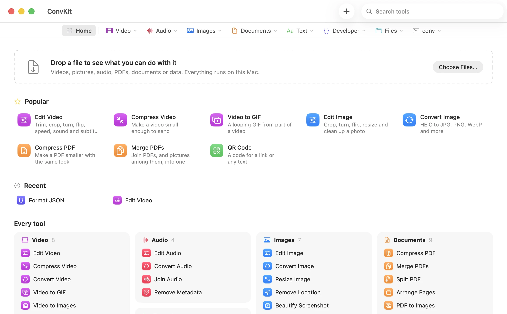
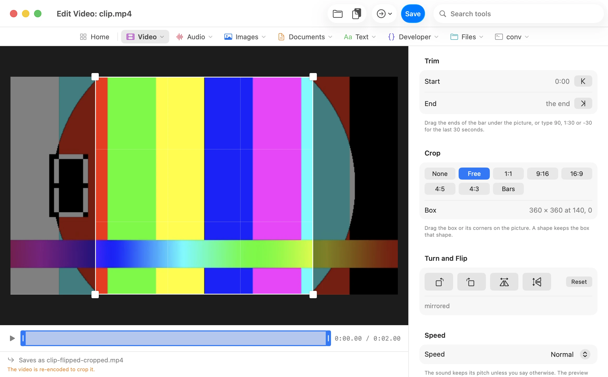
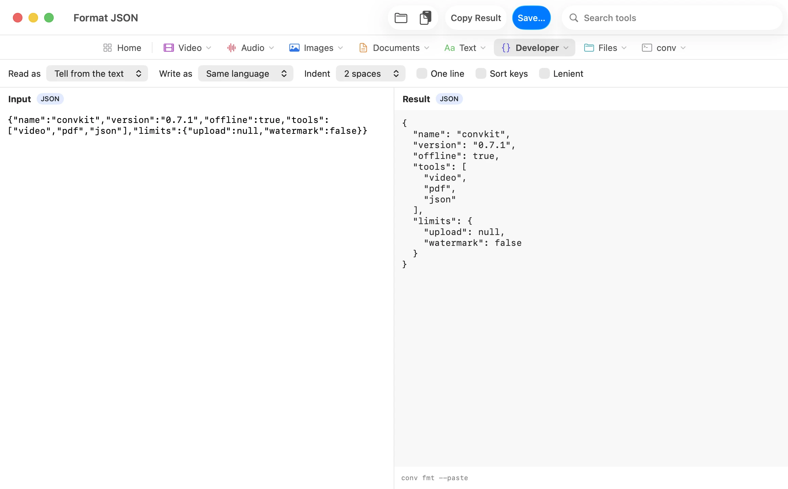

<h1 align="center">
  <picture>
    <source media="(prefers-color-scheme: dark)" srcset="docs/media/convkit-logo-dark.svg">
    
  </picture>
</h1>

<p align="center"></p>

<a href="docs/media/convkit-launch.mp4"></a>

<p align="center"><a href="docs/media/convkit-launch.mp4">▶ Watch the 22-second demo</a></p>

convkit is a free, offline toolbox for the file and text jobs people
usually pay an app for or hand to a website. One command, `conv`, converts
and compresses files, edits video and sound, merges, locks and shrinks
PDFs, reads QR codes, formats JSON and checks downloads, all on your own
machine. Nothing is uploaded, and there's no account, watermark or file
size limit. On a Mac the same tools also come as an [app](#the-mac-app).

```console
conv photo.heic .jpg                 # instead of a HEIC converter site
conv clip.mp4 --max-size 25mb        # instead of a video compressor
conv scan.pdf --compress             # instead of an online PDF compressor
conv merge a.pdf receipt.jpg out.pdf # instead of a PDF merger
conv report.pdf --password           # instead of a paid PDF editor
conv talk.mp4 --denoise              # instead of a noise removal service
conv clip.mp4 .jpg --every 2s        # instead of a frame extractor
conv clip.mp4 --subtitles subs.srt   # instead of a subtitle burner
conv qr --read photo.jpg             # instead of a QR scanner
conv jwt "$TOKEN"                    # instead of pasting a token into a decoder
conv data.json .yaml                 # instead of a JSON to YAML site
conv photos/ .zip                    # instead of an archive app
```

Under the hood conv picks the right tool for each job (ffmpeg,
ImageMagick, LibreOffice, pandoc, Typst, qpdf or the system's own speech
engine) and runs it with settings tuned for that conversion. The data
formats, archives and text tools are built in. That's 312 conversion pairs
across 47 formats (`conv capabilities` lists them), plus the tools in
[What's in the box](#whats-in-the-box). The only things that go online are `conv
install` and `conv update`, which fetch backends, and `conv link --follow`
when you ask it to.

```console
$ conv clip.mkv clip.mp4
OK clip.mp4 - 55 KB - 0.1s - stream copy, no re-encode
  /home/user/Videos/clip.mp4
```

Where it can, conv avoids re-encoding: a video whose codecs already fit the
new container is copied, which is lossless and measured 3.3× faster on a
2-second clip up to 71.7× on a 60-second 1080p one. On a real terminal
`OK`/`FAIL` render as green/red `✓`/`✗`; piped or redirected output (CI,
`| tee`) is plain ASCII with no escape codes.

## Install

Prebuilt binaries cover Windows x64, macOS x64/arm64, and Linux x64/arm64:

```console
# Linux / macOS
$ curl --proto '=https' --tlsv1.2 -LsSf \
    https://github.com/shdwfruit/convkit/releases/latest/download/convkit-installer.sh | sh
```

```powershell
# Windows
> irm https://github.com/shdwfruit/convkit/releases/latest/download/convkit-installer.ps1 | iex
```

```console
# Homebrew (macOS / Linux)
$ brew install shdwfruit/tap/convkit
```

An MSI (`convkit-x86_64-pc-windows-msvc.msi`) is also attached to each
release. The Windows binaries are not code-signed, so SmartScreen warns on
first run.

```console
# Cargo (any platform, builds from source)
$ cargo install convkit --locked
```

Building from source, as `cargo install` does, needs Rust 1.88 or newer and a C
compiler (on Windows, the MSVC build tools rustup already asks for). From a
checkout:

```console
$ git clone https://github.com/shdwfruit/convkit
$ cd convkit
$ cargo install --path crates/conv
```

conv does no encoding itself; see [Backends](#backends). A conversion that
needs a missing backend offers to install it.

## The Mac app

ConvKit puts conv's tools in a Mac window, for when a terminal is the wrong
place. Each tool has its own page with only the options that apply to it,
and an option that doesn't fit your file is greyed out, with the reason when
you hover over it. The editors trim, crop, turn and resize in one save, and
Then hands what one tool made straight to the next, so compressing a clip
you just cut doesn't mean finding the file first.

<p align="center"><picture>
  <source media="(prefers-color-scheme: dark)" srcset="docs/media/app-home-dark.webp">
  
</picture></p>

<p align="center"><picture>
  <source media="(prefers-color-scheme: dark)" srcset="docs/media/app-edit-video-dark.webp">
  
</picture> <picture>
  <source media="(prefers-color-scheme: dark)" srcset="docs/media/app-format-json-dark.webp">
  
</picture></p>

Every tool runs conv, so the app does exactly what the command does. It
isn't in a release yet. Building it takes macOS 14 and Xcode or the Command
Line Tools: run `apps/macos/build-app.sh`, and see
[`apps/macos`](apps/macos/README.md) for the rest.

## Quick start

```console
conv photo.heic .jpg              # new extension, same name: photo.jpg
conv in.mp4 out.gif               # or name the output
conv *.heic --to jpg -o ./out     # a batch, into another folder
conv clip.mp4 --max-size 25mb     # fit under a size, for an upload limit
conv clip.mp4 --start 5 --end 12  # cut out 0:05 to 0:12
conv clip.mp4 --crop 9:16         # crop to a shape, a box, or auto for black bars
conv photo.jpg --strip-metadata   # take out the location and camera details
conv merge a.pdf scan.jpg out.pdf # PDFs and photos in one PDF
conv split report.pdf 1-3 4-z     # one PDF per page range
conv scan                         # the files here and what each can become
conv info clip.mp4                # what a file is: streams, size, camera, pages
conv --paste .jpg                 # convert the picture or files you copied
conv fmt data.json                # pretty-print and check JSON, YAML or TOML
conv hash a.iso --check 3f2a...   # does the download match?
conv photos/ .zip                 # make photos.zip; conv photos.zip opens it
```

Every command is in the [guide](docs/guide.md#at-a-glance).

A single conversion reports size, elapsed time, and the absolute path the
result landed at:

```console
$ conv clip.mp4 clip.gif
OK clip.gif - 492 KB - 0.2s
  /home/user/Videos/clip.gif
```

A note follows when there is something to know about converting this
particular source: a transparent PNG flattened into a JPEG, say, or a GIF
made from a long video, which takes a lot of memory. A phone photo converted
to JPEG gets one only if it records where it was taken; see
[Location and metadata](docs/guide.md#location-and-metadata).

```console
$ conv logo.png logo.jpg
OK logo.jpg - 5 KB - 0.0s
  /home/user/Pictures/logo.jpg
  note  Transparency is flattened onto a white background; JPEG has no alpha channel.
```

`--dry-run` prints the exact backend command instead of running it — here,
the per-clip palette generation behind convkit's GIF default:

```console
$ conv clip.mp4 clip.gif --dry-run
ffmpeg -i clip.mp4 -vf 'fps=15,scale=w=min(640\,iw):h=-2:flags=lanczos,split[a][b];[a]palettegen=stats_mode=diff[p];[b][p]paletteuse=dither=bayer:bayer_scale=3' -loop 0 -y clip.gif
```

A failure never looks like a success, and carries its own fix — `try` names
whichever package manager is on `PATH` (winget/scoop/choco, brew,
apt-get/dnf/pacman):

```console
$ conv report.xlsx report.pdf
FAIL report.xlsx -> pdf
  soffice not found
  try  brew install --cask libreoffice
```

Exit codes, for scripting: `0` success, `1` conversion failed, `2` usage
error or unsupported pair, `3` a required backend is missing, `4` a batch
partly failed.

Every command also takes `--json`, which prints one JSON document for
scripts and agents; see
[Machine-readable output](docs/guide.md#machine-readable-output).

## What's in the box

The [guide](docs/guide.md) has a section for each job, with examples and
what conv decides for you.

**Video and sound.** [Fit it under a size](docs/guide.md#size-targets),
[cut a clip](docs/guide.md#cutting-a-clip),
[change the speed](docs/guide.md#changing-speed),
[clean up the sound](docs/guide.md#cleaning-up-sound),
[turn](docs/guide.md#rotating), [flip](docs/guide.md#flipping) or
[crop](docs/guide.md#cropping) it, [put on a new sound](docs/guide.md#new-sound),
[burn in subtitles](docs/guide.md#burning-in-subtitles) and
[save stills](docs/guide.md#stills-from-a-video).

**Pictures.** [Quality, size and colours](docs/guide.md#tuning-knobs),
[location and metadata](docs/guide.md#location-and-metadata),
[QR codes](docs/guide.md#qr-codes), [ASCII art](docs/guide.md#ascii-art),
[screenshots on a background](docs/guide.md#beautifying-screenshots) and
[a picture's main colours](docs/guide.md#colours-from-a-picture).

**PDFs and documents.** [Compress](docs/guide.md#compress-pdf),
[merge and split](docs/guide.md#merge-and-split),
[pick, reorder and turn pages](docs/guide.md#pages-of-a-pdf),
[add or take off a password](docs/guide.md#passwords-on-pdfs),
[pages as pictures](docs/guide.md#pdf-pages-as-pictures),
[documents, pictures and workbooks to PDF](docs/guide.md#making-pdfs),
[text, web pages and RTF](docs/guide.md#text-web-pages-and-rtf) and
[reading text aloud](docs/guide.md#reading-text-aloud).

**Text and developer tools.** [Base64, checksums, JWTs, timestamps, UUIDs,
clean links, word counts and diffs](docs/guide.md#text-and-developer-tools),
[JSON, YAML, TOML and CSV](docs/guide.md#json-yaml-toml-and-csv) and
[Wi-Fi passwords](docs/guide.md#wi-fi-passwords).

**Files.** [What a file is](docs/guide.md#file-info),
[zip and tar archives](docs/guide.md#archives),
[copy and paste](docs/guide.md#copy-and-paste),
[batches](docs/guide.md#batch-conversion) and
[which formats turn into which](docs/guide.md#discovering-formats-and-capabilities).

**Running conv.** [Backends](docs/guide.md#backends),
[updating](docs/guide.md#updating-convkit),
[JSON output](docs/guide.md#machine-readable-output) and
[troubleshooting](docs/guide.md#troubleshooting).

## Backends

conv runs other programs for the heavy lifting: ffmpeg for video and sound,
ImageMagick for pictures, LibreOffice and pandoc for documents, Typst and
qpdf for PDFs, and the system's own speech engine for reading aloud. The
data formats, archives and text tools are built in and need none of them.
`conv doctor` shows what's installed and how to get the rest. `conv install`
fetches pinned, checksum-checked builds of ffmpeg, pandoc, Typst and qpdf,
and a conversion that needs one of those offers to install it. ImageMagick
and LibreOffice come from your package manager. How conv finds each one is
in the [guide](docs/guide.md#backends).

## Updating

`conv update` brings the backends conv installed to the versions this build
pins, and prints the command that updates conv itself for however you
installed it. `conv changelog --since 0.6.0` lists what's new since the
version you had. More in the [guide](docs/guide.md#updating-convkit).

## Design notes

- [`docs/defaults-calibration.md`](docs/defaults-calibration.md) — every
  default, measured, with the exact commands to reproduce each figure.
- [`docs/design.md`](docs/design.md) — the original design rationale: prior
  art, why Rust, and the non-goals list. Marked historical: it records where
  the implementation has since diverged from it.

## Contributing

See [CONTRIBUTING.md](CONTRIBUTING.md) for building, testing and adding a
conversion pair. Issues labelled
[good first issue](https://github.com/shdwfruit/convkit/labels/good%20first%20issue)
are a good place to start, and questions go in
[Discussions](https://github.com/shdwfruit/convkit/discussions).

## License

Dual-licensed under [MIT](LICENSE-MIT) or [Apache-2.0](LICENSE-APACHE), your
choice. convkit invokes ffmpeg, ImageMagick, LibreOffice, pandoc, Typst, and qpdf
as subprocesses; it does not link against, embed, or redistribute any of
them, and each keeps its own license. `conv install` downloads official
upstream builds straight from their publishers.

`conv ascii` draws text in PNGs with glyphs from
[JetBrains Mono](https://github.com/JetBrains/JetBrainsMono), under the
SIL Open Font License 1.1; the licence is in
[JetBrainsMono-OFL.txt](crates/convkit-core/src/ascii/JetBrainsMono-OFL.txt)
and in every release archive.

`conv chars` names characters from the Unicode Character Database, © Unicode,
Inc., under the [Unicode License](https://www.unicode.org/license.txt).
