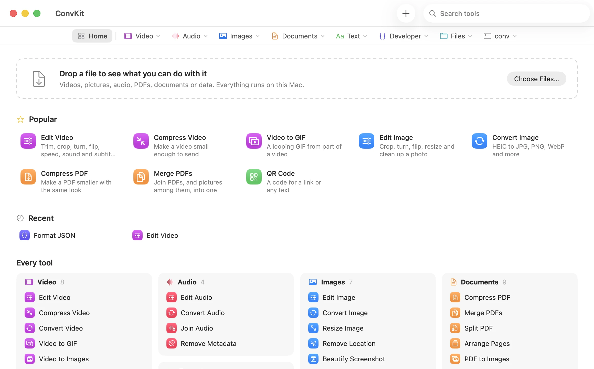

# ConvKit for Mac

A SwiftUI toolbox for conv. Each tool does one job, and every tool runs on your Mac.

<picture>
  <source media="(prefers-color-scheme: dark)" srcset="../../docs/media/app-home-dark.webp">
  
</picture>

Finding a tool
- The bar at the top has Home and one dropdown per section: Video, Audio,
  Images, Documents, Text, Developer, Files and conv. Each lists its tools
  with what they do, and the section of the tool you're in is marked.
- Search in the toolbar matches names, descriptions and formats, so "heic"
  finds the picture tools and "shrink" finds Compress Video. The matches drop
  down over the page you're on. Return opens the first one, Escape closes it.
- Home shows the popular tools, the ones you used last, and every section.
- Drop a file on Home and it lists the tools that fit that file. Pick one and
  the file is already in it. Files opened from Finder or the Dock work the same
  way, unless the tool showing takes them.

The tools
- Video: Edit Video, Compress, Convert, Video to GIF, Video to Images (stills),
  Extract Audio, Join, Remove Metadata.
- Audio: Edit Audio, Convert, Join, Remove Metadata.
- Images: Edit Image, Convert, Resize, Remove Location, Beautify Screenshot,
  Color Palette, Make an Icon.
- Documents: Compress PDF, Merge PDFs (pictures among them too), Split PDF,
  Arrange Pages, PDF to Images, Photos to PDF, Lock PDF, Unlock PDF, Convert
  Document.
- Text: QR Code, Read QR Code, Text to Speech, ASCII Art, Word Count, Change
  Case, Clean Links, Hidden Characters, Compare Text, Lorem Ipsum, Wi-Fi
  Password.
- Developer: Format JSON (`conv fmt` as you type), Convert Data, Base64,
  Checksum, JWT Decoder, Timestamps, UUID.
- Files: Convert Anything (every format and option), File Info, Zip Files,
  Open Archive, Scan Folder.
- conv: Backends (install and update what conv uses), Formats, What's New.

The editors
- Edit Video, Edit Audio and Edit Image take one file and make every change
  at once: trim on the bar under the picture, crop with a box on it (or a
  shape like 9:16, or cut away black bars), turn and flip, speed, mute, take
  out noise, put on a new sound or subtitles, resize, change the format and
  take out the metadata. The preview shows the turn, the flip, the crop and
  the part kept. Saving is one conv run, so nothing is re-encoded twice.
- Searching for Crop Video, Trim Video, Mute Video, Change Speed, Remove
  Noise and the like opens the editor at that part.
- Mute needs a conv with `--mute`; until then the switch says so.

Chains
- Next to the main button, Then runs this step without saving it and hands
  what it makes to the next tool: join two clips, then compress them; arrange
  a PDF's pages, then compress and lock it. The menu lists only the tools
  that take what this step makes.
- Each step's result waits in a scratch folder. The last step saves next to
  the file the chain started from, named for every step
  (photo-cropped-stripped.jpg), and never over that file. The bar above the
  tool shows the steps; click one to go back and change it.
- After a save, Open In does the same with the saved file.

Most tools are Convert with a narrower form: the same `conv FILE .ext --flags`,
but showing only the options for that job. More Options carries the files
and settings into Convert Anything.

The small text and developer tools run their conv command as you type and
show what it prints. Text goes to conv on a pipe, so a long paste or one
starting with a dash is fine.

Options that don't fit the files are greyed out, and hovering says why: a
PNG has no quality setting, a picture has no frame rate, End and a length
can't both be set. Convert Anything greys out everything until a file is
added. What fits comes from conv itself: `conv capabilities` for each format,
and, when a file keeps its format, what its own sources take on the way to
it and it takes on the way out. The one exception is a PDF kept as a PDF
(compress, size, lock, unlock), which `capabilities` doesn't list as a pair.
A file a tool doesn't take is listed but left out, with a pointer to Convert
Anything.

Passwords (Lock PDF, Unlock PDF, a locked zip, a JWT secret) go to conv in
an environment variable, never on its command line.

The app runs the `conv` binary and doesn't copy any of conv's rules. The name
of each new file, and any problem, come from `conv --dry-run --json` as you
change options. Conversions run with `--json`.

It never overwrites or forces anything on its own. If the new file already
exists, the row offers Replace. If a size limit is too small, the row shows
conv's warning and offers Convert Anyway.

A tool only shows when your conv has the command behind it, so new conv
commands can get a tool without breaking older installs.

## Build

Needs macOS 14 and the Swift toolchain (Xcode or the Command Line Tools).

    ./build-app.sh                 # build/ConvKit.app, uses conv from your PATH
    ./build-app.sh --bundle-conv   # also copies ../../target/release/conv inside

Or run it straight from the package:

    swift run ConvKit ~/Movies/clip.mov

The app looks for conv in Settings, then `$CONV_BIN`, then inside the app,
then `~/.local/bin`, `/opt/homebrew/bin`, `/usr/local/bin` and `~/.cargo/bin`.

## Not yet

- Not in a release yet, so build it as above.
- No progress bar for a single file, because conv's `--json` mode reports at the end.
- One file at a time.
- Unsigned. Gatekeeper will ask the first time it's opened from a download.
